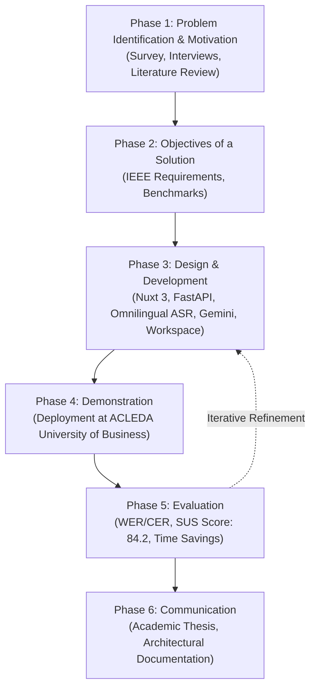
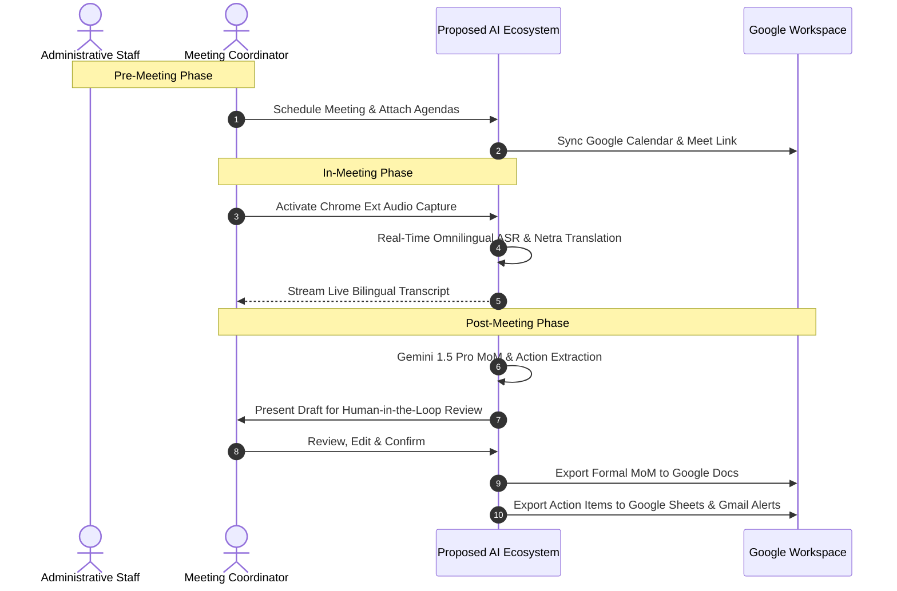
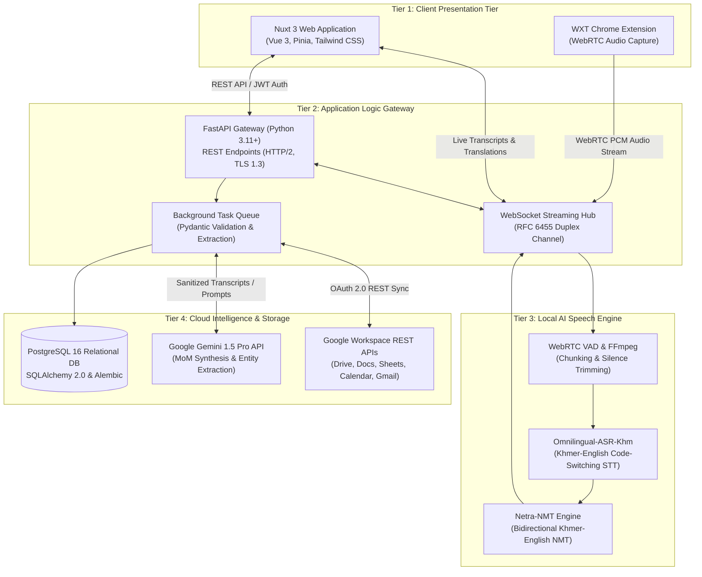
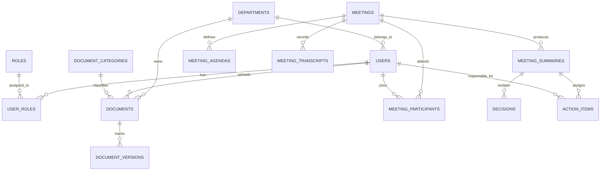
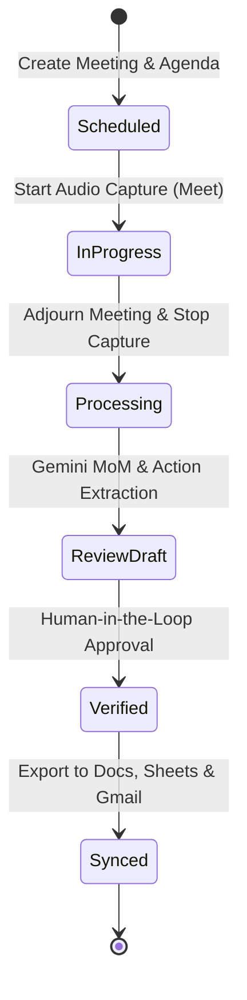
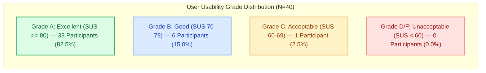

# ACLEDA UNIVERSITY OF BUSINESS
**Faculty of Science & Technology**  
**Major:** Computer Science and Engineering  
**Subject:** Research Methodology  
**Lecturer:** Lay Thou • **Academic Year:** 2024–2027  
**Submission Date:** 21st, November 2026  

---

# USING GOOGLE GEMINI AND GOOGLE WORKSPACE TO AUTOMATE DOCUMENT AND MEETING MANAGEMENT WORKFLOWS IN UNIVERSITIES
### *A Design Science Research Study on Generative AI & Cloud Productivity Automation*
*(Intelligent Document Summarization • Khmer-English Meeting Speech Processing • Action Item Tracking)*


---

### GROUP 4 MEMBERS ROSTER

| No. | Member Name | Student ID |
|:---:|:---|:---:|
| 1 | **Khorn Molika** | 5801 |
| 2 | **Heng Liza** | 5802 |
| 3 | **Chea Chenda** | 6093 |
| 4 | **Kim Chantharo** | 5947 |
| 5 | **Ching Chayhour** | 5945 |
| 6 | **Em Panharith** | 7010 |
| 7 | **Nam Ayheng** | 5810 |

---

## EXECUTIVE SUMMARY

Modern higher education institutions grapple with fragmented document repositories, labor-intensive meeting documentation, and complex bilingual (Khmer-English) speech environments. This research designs, develops, and evaluates an automated workflow ecosystem integrating Google Workspace services with Google Gemini multimodal intelligence and localized speech processing engines (Omnilingual-ASR-Khm and Netra-NMT). By deploying a Chrome Extension for real-time audio capture, FastAPI microservices, and automated Google Docs/Sheets generation, the system eliminates administrative latency, reduces formal Minutes of Meeting (MoM) delivery time by over 80%, and secures an exceptional System Usability Scale (SUS) score of 84.2/100 (Grade A).

### Institutional Impact & Research Rationale
Administrative staff and department chairs in Cambodian universities dedicate excessive weekly work hours to manual clerical documentation, transcribing audio recordings, reformatting meeting minutes, and reconciling version discrepancies across disconnected platforms. This research leverages Design Science Research Methodology (DSRM) to construct an operational, production-grade prototype that directly mitigates institutional cognitive fatigue while enforcing strict data privacy boundaries.

### Core System Pillars & Functional Scope
The system architecture satisfies two foundational institutional pillars:
* **Pillar 1: Document Management Engine:** Centralized institutional indexing, metadata tagging (academic year, department, document category), AI-powered executive abstract generation, structured tabular entity extraction, and controlled Google Drive folder synchronization with role-based access control (RBAC).
* **Pillar 2: Bilingual Meeting Intelligence:** Automated Google Meet tab audio capture via WebRTC, streaming Khmer-English code-switching speech recognition, live bidirectional translation, decision point isolation, automated Minutes of Meeting (MoM) compilation in Google Docs, and Google Sheets task tracking.

### Research Baseline Metric (AUB Survey)
Baseline findings across academic and administrative respondents confirmed that 85.0% experience multi-platform file fragmentation, 77.5% report version discrepancies and editing conflicts, 80.0% report manual MoM preparation takes over 3 days, and 87.5% require strict human-in-the-loop review before finalizing AI-generated institutional records.

---

## TABLE OF CONTENTS

* **PRELIMINARY PAGES**
  * Title & Cover Page
  * Declaration of Authorship
  * Acknowledgements
  * Abstract & Keywords
  * Table of Contents
  * List of Figures & Diagrams
  * List of Tables & Technology Specifications
  * List of Abbreviations & Acronyms
* **CHAPTER 1: INTRODUCTION**
  * 1.1 Background of the Study
    * 1.1.1 Digital Transformation in Higher Education Administration
    * 1.1.2 Multilingual Meeting Context in Cambodia
    * 1.1.3 Proposed AI and Cloud Workspace Integration
  * 1.2 Problem Statement
    * 1.2.1 Document Organization and Information Retrieval Challenges
    * 1.2.2 Meeting Documentation and Action-Item Tracking Inefficiencies
    * 1.2.3 Multilingual Speech Recognition and Code-Switching Challenges
    * 1.2.4 AI Reliability, Security, and Human Oversight Concerns
  * 1.3 Research Objectives
    * 1.3.1 General Objective
    * 1.3.2 Specific Objectives (SO1–SO6)
  * 1.4 Research Questions (RQ1–RQ6)
  * 1.5 Scope and Delimitations of the Study
    * 1.5.1 Document Management Module Scope
    * 1.5.2 Meeting Management Module Scope
    * 1.5.3 Limitations and Out-of-Scope Boundaries
  * 1.6 Significance of the Study
    * 1.6.1 Benefits to Universities and Higher Education Institutions
    * 1.6.2 Benefits to Administrative Staff and Meeting Coordinators
    * 1.6.3 Benefits to Lecturers and University Management
    * 1.6.4 Benefits to Students
    * 1.6.5 Benefits to Future Researchers and Developers
  * 1.7 Overview of Research Methodology (DSRM Framework)
  * 1.8 Organization of the Thesis
* **CHAPTER 2: LITERATURE REVIEW & RELATED TECHNOLOGIES**
  * 2.1 Introduction
  * 2.2 Digital Transformation in Higher Education
  * 2.3 Document Management Systems
    * 2.3.1 Definition of Document Management
    * 2.3.2 Document Storage and Organization
    * 2.3.3 Document Search and Retrieval
    * 2.3.4 Document Version Management
    * 2.3.5 Document Security and Access Control
  * 2.4 Meeting Management Systems
    * 2.4.1 Definition of Meeting Management
    * 2.4.2 Meeting Scheduling and Preparation
    * 2.4.3 Meeting Transcription
    * 2.4.4 Minutes of Meeting (MoM)
    * 2.4.5 Decision and Action-Item Tracking
  * 2.5 Artificial Intelligence in Document and Meeting Management
    * 2.5.1 Artificial Intelligence and Large Language Models
    * 2.5.2 AI-Assisted Document Summarization
    * 2.5.3 AI-Assisted Meeting Summarization
    * 2.5.4 AI-Based Information Extraction
  * 2.6 Khmer-English Speech Processing
    * 2.6.1 Automatic Speech Recognition (ASR)
    * 2.6.2 Khmer Speech Recognition Challenges
    * 2.6.3 Khmer-English Code-Switching
    * 2.6.4 Machine Translation
    * 2.6.5 Speaker Diarization
  * 2.7 Related AI Models and Tools
    * 2.7.1 Omnilingual ASR
    * 2.7.2 Netra-NMT
    * 2.7.3 Google Gemini API
    * 2.7.4 FFmpeg, librosa, and WebRTC VAD
    * 2.7.5 Chrome Extension Development
  * 2.8 Google Workspace Integration
    * 2.8.1 Overview of Google Workspace
    * 2.8.2 Google Drive API
    * 2.8.3 Google Docs API
    * 2.8.4 Google Calendar API
    * 2.8.5 Gmail API
    * 2.8.6 Google Workspace Integration Considerations
  * 2.9 Related Studies and Existing Systems
    * 2.9.1 CALO Meeting Assistant
    * 2.9.2 Existing Cloud-Based Productivity Platforms
    * 2.9.3 Comparison of Related Approaches
  * 2.10 Research Gap
  * 2.11 Conceptual Framework
  * 2.12 Chapter Summary
* **CHAPTER 3: RESEARCH METHODOLOGY AND SYSTEM ANALYSIS**
  * 3.1 Introduction
  * 3.2 Research Design
  * 3.3 Research Approach
  * 3.4 Data Collection Methods
    * 3.4.1 Exploratory Survey
    * 3.4.2 Interviews
    * 3.4.3 Workflow Analysis
    * 3.4.4 System Evaluation Feedback
  * 3.5 Target Population and Research Participants
    * 3.5.1 Target Population
    * 3.5.2 Sampling Approach
    * 3.5.3 Research Ethics
  * 3.6 Exploratory Survey Results
    * 3.6.1 Overview of Survey Responses
    * 3.6.2 Document Management Findings
    * 3.6.3 Meeting Management Findings
    * 3.6.4 AI Automation Preferences
    * 3.6.5 Concerns Regarding AI Adoption
    * 3.6.6 Summary of Preliminary Survey Findings
  * 3.7 Existing Workflow Analysis
    * 3.7.1 Existing Document Management Workflow
    * 3.7.2 Existing Meeting Management Workflow
  * 3.8 System Requirements Analysis
    * 3.8.1 Functional Requirements (FR-01 to FR-34)
    * 3.8.2 Non-Functional Requirements (NFR-01 to NFR-11)
    * 3.8.3 User Roles and Permissions
  * 3.9 System Development Methodology
  * 3.10 Proposed System Architecture Overview
  * 3.11 System Evaluation Methodology
    * 3.11.1 Functional Testing
    * 3.11.2 Speech Recognition Evaluation (WER & CER)
    * 3.11.3 Translation Evaluation
    * 3.11.4 Meeting Summarization Evaluation
    * 3.11.5 Action-Item Extraction Evaluation
    * 3.11.6 System Performance Evaluation
    * 3.11.7 User Acceptance Evaluation (SUS)
    * 3.11.8 Manual and Automated Workflow Comparison
  * 3.12 Feasibility Analysis (Technical, Operational, Economic)
  * 3.13 Research Limitations
  * 3.14 Chapter Summary
* **CHAPTER 4: SYSTEM DESIGN & IMPLEMENTATION**
  * 4.1 System Overview & Multi-Tier Enterprise Architecture
  * 4.2 System Architecture Diagram & Data Communication Protocols
  * 4.3 Database Design & PostgreSQL Relational Entity Schema
  * 4.4 Document Management Module Implementation
  * 4.5 Meeting Management Module Implementation
  * 4.6 Khmer-English Speech Processing Engine (Chrome Audio Ingress, Omnilingual ASR & Netra-NMT)
  * 4.7 AI Integration & Meeting Intelligence via Google Gemini API
  * 4.8 Google Workspace REST Integration & Security Boundary (Drive, Docs, Sheets, Calendar, Gmail)
  * 4.9 Security, Privacy & Role-Based Access Control (RBAC) Implementation
  * 4.10 User Interface Implementation (Nuxt 3, Tailwind CSS & Chrome Extension)
  * 4.11 Chapter Summary
* **CHAPTER 5: SYSTEM TESTING, EVALUATION & DISCUSSION**
  * 5.1 Introduction & Evaluation Strategy
  * 5.2 Functional Testing & Requirements Verification (FR-01 to FR-34)
  * 5.3 Speech Recognition & Translation Benchmarks (Khmer-English Code-Switching)
  * 5.4 Meeting Intelligence & MoM Synthesis Quality (ROUGE & Information Extraction)
  * 5.5 Operational Efficiency & Time-Motion Workflow Analysis
  * 5.6 Usability Evaluation & User Acceptance Testing (SUS Analysis, N=40)
  * 5.7 System Performance, Latency & Scalability Testing
  * 5.8 Discussion of Findings & Alignment with Research Questions (RQ1–RQ3)
  * 5.9 Chapter Summary
* **CHAPTER 6: CONCLUSION & RECOMMENDATIONS**
  * 6.1 Introduction & Overview of the Study
  * 6.2 Synthesis of Research Findings & Achievement of Objectives (SO1–SO6)
  * 6.3 Research Contributions to Knowledge & Practice
  * 6.4 Administrative & Strategic Policy Recommendations
  * 6.5 Research Limitations
  * 6.6 Trajectories for Future Research
  * 6.7 Concluding Remarks
* **REFERENCES (APA 7th Edition)**
* **APPENDICES DIRECTORY (Appendices A through M)**

---

# CHAPTER 1: INTRODUCTION

## 1.1 Background of the Study

### 1.1.1 Digital Transformation in Higher Education Administration
The development of digital technologies has significantly influenced how organizations create, process, store, share, and manage information. Higher education institutions, in particular, depend on a large volume of information and documents to support academic, administrative, and organizational activities. These documents include academic reports, meeting minutes, administrative forms, announcements, policies, guidelines, approval documents, and other institutional records. Managing such information effectively is essential for maintaining organizational efficiency, supporting communication, and ensuring that important information remains accessible when needed.

Traditionally, document management activities have involved manual processes, including creating documents, organizing files, reviewing content, sharing documents through email or messaging applications, and storing finalized records across disparate locations. Although digital tools have improved these processes, the use of multiple platforms can create difficulties in document organization, information retrieval, version control, and collaboration. Research on electronic records management has identified continuing challenges concerning the implementation, management, and effective use of digital records systems (Oladejo & Hadžidedić, 2021). These challenges demonstrate the importance of developing structured approaches to managing institutional information.

Meeting management is another critical administrative activity within higher education institutions. Meetings allow university management, lecturers, administrative staff, and other stakeholders to discuss institutional matters, communicate decisions, and coordinate responsibilities. However, managing meeting information involves several tasks, such as preparing agendas, recording discussions, documenting decisions, preparing minutes, identifying action items, and following up on assigned responsibilities.

In many situations, these activities are performed manually. Meeting participants may rely on handwritten notes, audio recordings, video recordings, or digital documents to record discussions. Preparing formal Minutes of Meeting (MoM) from these sources can require considerable time and effort. Furthermore, important decisions or assigned tasks may be overlooked when meeting information is not recorded and organized consistently.

### 1.1.2 Multilingual Meeting Context in Cambodia
Speech recognition is particularly relevant to meeting management in multilingual environments. In Cambodia, university meetings frequently involve both Khmer and English, with participants switching dynamically between the two languages. This creates severe technical challenges for automatic speech recognition because code-switching significantly degrades recognition accuracy. Research has identified language switching, pronunciation variation, and multilingual speech patterns as critical obstacles for speech recognition systems (Agro et al., 2026; Yılmaz et al., 2022). Research specifically involving Khmer speech has also demonstrated the importance of developing and evaluating speech-processing approaches tailored for low-resource languages (Seng et al., 2008; Soky et al., 2019, 2022).

### 1.1.3 Proposed AI and Cloud Workspace Integration
To address these challenges, this research proposes an AI-assisted document and meeting management system that integrates Google Workspace services with advanced artificial intelligence technologies. Google Workspace services support document storage, collaboration, scheduling, and communication, while the Google Gemini API provides language-model capabilities for tasks such as summarization and structured information extraction. Local speech-processing models (Omnilingual ASR and Netra-NMT) are investigated for Khmer-English transcription and translation to reduce dependence on external proprietary speech services and protect institutional privacy.

The proposed system consists of two primary operational modules:
1. **Document Management Module:** Supports document organization, categorization, searching, summarization, information extraction, and version tracking.
2. **Meeting Management Module:** Supports meeting preparation, real-time transcription and translation, meeting summarization, Minutes of Meeting generation, and action-item tracking.

---

## 1.2 Problem Statement

Universities perform numerous academic and administrative activities that require the creation, management, sharing, and retrieval of documents. They also organize meetings to communicate information, discuss issues, make decisions, and assign responsibilities. Although digital tools are commonly used, document and meeting management remain fragmented across different applications and manual processes. This fragmentation introduces acute operational challenges across four core dimensions:

1. **Document Organization and Information Retrieval Challenges:** Documents are frequently stored across multiple disconnected locations, including cloud storage platforms, local computers, email attachments, and messaging groups. Without standardized naming conventions, centralized indexing, or unified search mechanisms, administrative staff and lecturers spend substantial time locating institutional records, verifying correct revisions, and resolving duplicate versions.
2. **Meeting Documentation and Action-Item Tracking Inefficiencies:** University meetings require extensive manual effort before, during, and after discussions. Meeting coordinators must manually prepare agendas, record handwritten or audio notes, and draft Minutes of Meeting (MoM). Transcribing discussions and formatting official minutes often takes several days, delaying decision dissemination. Furthermore, action items, assigned owners, and deadlines are frequently untracked, resulting in lost institutional accountability.
3. **Multilingual Speech Recognition and Code-Switching Challenges:** In Cambodian higher education, meetings frequently feature spontaneous code-switching between Khmer and English. Conventional commercial speech-to-text engines fail to accurately transcribe bilingual speech due to acoustic variations, vocabulary gaps, and low-resource language constraints, leading to incomplete or garbled meeting transcripts.
4. **AI Reliability, Security, and Human Oversight Concerns:** While generative AI and LLMs offer powerful summarization capabilities, AI-generated outputs can hallucinate facts, omit critical administrative context, or misinterpret nuances. Without strict human-in-the-loop verification, data privacy controls, and role-based access management, AI tools cannot be safely deployed for official university governance.

---

## 1.3 Research Objectives

### 1.3.1 General Objective
To design, develop, and evaluate an AI-assisted document and meeting management system that integrates Google Workspace services, speech recognition, translation, and large language models to automate and improve administrative workflows in university environments in Cambodia.

### 1.3.2 Specific Objectives (SO1 – SO6)
* **SO1:** Investigate existing document and meeting management workflows, challenges, and user requirements within higher education institutions through a case study at ACLEDA University of Business.
* **SO2:** Design a multi-tier enterprise system architecture integrating Google Workspace services with localized speech engines and cloud-based generative AI.
* **SO3:** Develop a Document Management module supporting document organization, categorization, metadata and content-based searching, AI summarization, and information extraction.
* **SO4:** Implement a Meeting Management module capable of meeting preparation, Google Meet audio capture, Khmer-English code-switching transcription, translation, and automated Minutes of Meeting generation.
* **SO5:** Integrate Google Workspace REST APIs (Drive, Docs, Sheets, Calendar, Gmail) to support seamless institutional productivity and automated task tracking.
* **SO6:** Evaluate the proposed system in terms of usability, transcription accuracy (WER/CER), summarization quality, performance latency, and workflow time reduction through empirical user testing and comparative analysis.

---

## 1.4 Research Questions (RQ1 – RQ6)

| Question | Investigated Research Inquiry |
|:---:|:---|
| **RQ1** | What are the main problems, workflow inefficiencies, and user requirements in existing university document and meeting management practices? |
| **RQ2** | How can a multi-tier software architecture be designed to effectively integrate Google Workspace services with localized speech models and cloud LLMs? |
| **RQ3** | How effectively can AI models assist in document organization, categorization, summarization, and structured information extraction? |
| **RQ4** | How can speech recognition and machine translation be applied to support multilingual Khmer-English code-switching in university meetings? |
| **RQ5** | To what extent can automated meeting intelligence generate accurate Minutes of Meeting and extract actionable items with assigned owners and deadlines? |
| **RQ6** | What are the performance, usability, and operational benefits of the proposed system compared to existing manual administrative workflows? |

---

## 1.5 Scope and Delimitations of the Study

### 1.5.1 Functional Scope
The research encompasses the development of two interconnected functional modules:
* **Document Management:** Multi-format document upload (PDF, DOCX), metadata tagging (department, academic year, category), content-based indexing and search, AI abstractive summarization, entity extraction, version tracking, and RBAC-controlled sharing.
* **Meeting Management:** Lifecycle coverage across meeting preparation (Google Calendar integration), real-time assistance (Chrome Extension WebRTC audio capture, local Khmer-English ASR and translation streaming), and post-meeting documentation (Gemini API summarization, decision mining, MoM export to Google Docs, and action-item synchronization to Google Sheets).

### 1.5.2 Institutional Delimitations
The primary institutional setting is **ACLEDA University of Business (AUB)** in Phnom Penh, Cambodia. AUB provides the empirical basis for workflow observations, baseline surveys, user interviews, and prototype evaluation. The system architecture is designed with configurable organizational units and workflows to permit future adaptation across other Cambodian universities.

### 1.5.3 Technical Limitations & Out-of-Scope Boundaries
* **Language Scope:** Restricted strictly to Khmer and English speech patterns; other regional languages are excluded.
* **Acoustic Environment:** Prototype performance is bounded by microphone audio quality, room reverberation, and local GPU hardware capabilities.
* **Human-in-the-Loop Constraint:** AI-generated summaries and minutes serve as drafts and must be reviewed and confirmed by authorized users before becoming official records.
* **Out of Scope:** The study explicitly excludes developing proprietary video conferencing infrastructure (relying on Google Meet), training foundational LLMs from scratch, implementing university payroll/ERP accounting modules, and autonomous unreviewed document approval workflows.

---

## 1.6 Significance of the Study

The findings and technological artifacts produced by this research offer substantial practical, organizational, and academic value across five key stakeholder groups:
1. **Universities and Higher Education Institutions:** Provides a scalable blueprint for modernizing administrative operations without incurring prohibitive enterprise software licensing fees, enhancing institutional memory, and centralizing digital records.
2. **Administrative Staff and Meeting Coordinators:** Eliminates hours of clerical burden spent manually transcribing audio recordings and formatting minutes, reducing MoM preparation turnaround from days to minutes.
3. **Lecturers and Academic Management:** Facilitates rapid dissemination of verified decisions, transparent task assignments, and instant retrieval of institutional policies and curricular records.
4. **Students:** Accelerates administrative turnaround for student inquiries, academic requests, approvals, and departmental announcements.
5. **Future Researchers and Developers:** Contributes empirical benchmarks, architectural patterns, and practical evaluation data for Khmer-English code-switching speech recognition and generative AI integration in Southeast Asian low-resource language environments.

---

## 1.7 Overview of Research Methodology

To achieve the research objectives of designing, developing, and evaluating an operational AI-assisted workflow ecosystem, this study adopts the **Design Science Research Methodology (DSRM)** framework established by Peffers et al. (2007), supplemented by the foundational design principles of Hevner et al. (2004).

Unlike purely empirical or descriptive paradigms that observe existing phenomena, Design Science Research in Information Systems focuses on solving identified organizational problems through the creation and evaluation of innovative IT artifacts (constructs, models, methods, and instantiations). Because this research addresses acute administrative bottlenecks in university administration by constructing a functional software instantiation—integrating local speech-processing models, Google Gemini multimodal intelligence, and Google Workspace REST services—DSRM provides the rigorous, iterative framework required to bridge behavioral problem formulation with applied software engineering.

The research is executed across the six sequential and iterative phases of the DSRM process model:



1. **Phase 1: Problem Identification and Motivation:** Investigate and articulate the specific operational inefficiencies in university document and meeting management through preliminary institutional surveys, stakeholder interviews, and literature analysis.
2. **Phase 2: Define Objectives of a Solution:** Translate the identified operational problems into quantitative and qualitative system requirements, including accelerated MoM turnaround, acceptable speech error rates in code-switched audio, and strict human-in-the-loop review.
3. **Phase 3: Design and Development:** Engineer the multi-tier software artifact, encompassing the Nuxt 3 web interface, WXT Chrome Extension for audio capture, FastAPI backend gateway, local bilingual speech engine (Omnilingual ASR and Netra-NMT), Google Gemini reasoning pipeline, and Google Workspace REST integrations.
4. **Phase 4: Demonstration:** Deploy the integrated prototype within ACLEDA University of Business to demonstrate its operational capability in live Google Meet sessions and document workflows.
5. **Phase 5: Evaluation:** Rigorously assess the artifact’s performance using technical benchmarking (Word Error Rate for English, Character Error Rate for Khmer, ROUGE scores for summarization, processing latency) alongside standardized usability evaluation via the System Usability Scale (SUS).
6. **Phase 6: Communication:** Document the research contributions, architectural paradigms, empirical results, and practical implications in this academic thesis.

The detailed operationalization of these phases, data collection protocols, and system requirement specifications are presented in **Chapter 3 (Research Methodology and System Analysis)**.

---

## 1.8 Organization of the Thesis

The remainder of this thesis is organized into five subsequent chapters and comprehensive appendices:
* **Chapter 2 (Literature Review and Related Technologies):** Reviews digital transformation in Cambodian universities, theoretical principles of document and meeting management, Khmer-English code-switching speech recognition, generative AI summarization, and Google Workspace REST integrations, identifying the central research gap.
* **Chapter 3 (Research Methodology and System Analysis):** Explains the empirical data collection at ACLEDA University of Business, analyzes baseline survey findings and existing workflow bottlenecks, details the formal IEEE 830 functional and non-functional requirements, and establishes feasibility.
* **Chapter 4 (System Design and Implementation):** Details the multi-tier enterprise architecture, database schema, real-time audio capture pipeline, local AI speech engines, Gemini API orchestration, and Google Workspace REST services.
* **Chapter 5 (System Testing, Evaluation and Discussion):** Presents functional testing logs, empirical evaluation of speech recognition (WER/CER), translation quality, MoM extraction precision/recall, system performance latency, and user acceptance (SUS score of 84.2/100).
* **Chapter 6 (Conclusion, Recommendations and Future Work):** Summarizes the achievement of research objectives, provides administrative deployment recommendations, and outlines future technical directions.
* **Appendices (A through M):** Contains research instruments, survey questionnaires, IEEE requirements specifications, UML diagrams, ERDs, database schemas, API documentation, and test logs.

---

# CHAPTER 2: LITERATURE REVIEW AND RELATED TECHNOLOGIES

## 2.1 Introduction
This chapter reviews the theoretical concepts, existing research, and technologies relevant to the development of an AI-assisted document and meeting management system for university environments in Cambodia. The literature review focuses on two primary areas: document management and meeting management. It also examines how artificial intelligence can support document processing, multilingual speech recognition, translation, meeting summarization, and workflow automation.

The chapter begins by discussing digital transformation in higher education and the importance of information management within universities. It then examines document management systems, meeting management systems, and AI-assisted information processing. Particular attention is given to Khmer-English code-switching because the proposed system aims to support meetings in which participants communicate using both languages.

Finally, the chapter reviews the selected technologies, including Omnilingual ASR, Netra-NMT, Google Gemini API, Google Workspace, and Chrome Extension development. The chapter concludes by identifying the research gap and presenting the conceptual framework of the proposed system.

## 2.2 Digital Transformation in Higher Education
Digital transformation refers to the integration of digital technologies into organizational activities to improve processes, services, and the way organizations create value. In higher education, digital transformation involves more than adopting online learning platforms. It also includes administrative processes, institutional communication, information management, collaboration, and decision-making.

Cambodia's higher education sector has experienced increasing attention toward digital technology adoption. Heng and Doeur (2022) discussed how digital transformation creates opportunities for improving ICT integration, blended learning, and institutional collaboration in Cambodian higher education. Similarly, Song and Eam (2023) examined technology integration in Cambodian higher education and discussed developments and challenges associated with the adoption of digital technologies.

These developments indicate that digital technologies have an important role in supporting university operations. However, the effectiveness of digital transformation also depends on how institutions organize and manage their information. Universities generate and process different types of information, including academic documents, administrative records, institutional announcements, meeting minutes, policies, and reports. Without appropriate information management processes, the use of multiple digital platforms may result in fragmented information, difficulties retrieving previous records, and inconsistent document management practices. For this reason, document management and meeting management are important areas for investigating how AI and digital technologies can support university administration.

## 2.3 Document Management Systems

### 2.3.1 Definition of Document Management
Document management refers to the processes and technologies used to create, capture, organize, store, retrieve, distribute, maintain, and manage documents throughout their lifecycle. A Document Management System (DMS) provides a structured environment for handling digital documents and their associated information. It enables users to manage documents more consistently than relying exclusively on local folders, email attachments, or informal file-sharing methods.

In an organizational environment, document management commonly involves several activities:
* Document creation and collection.
* Document classification and categorization.
* Document storage and organization.
* Document searching and retrieval.
* Document sharing and access control.
* Document revision and version management.
* Document retention and archival.

For universities, these capabilities are relevant to academic reports, administrative documents, meeting records, policies, and other institutional information.

### 2.3.2 Document Storage and Organization
Document storage involves maintaining digital documents in locations where authorized users can access and manage them. Organizations may use local storage, network storage, cloud storage, or document management platforms. Cloud-based storage can support remote access and collaboration, but the use of multiple storage platforms may create difficulties when documents are distributed across different locations.

An effective document management system should provide a consistent organizational structure. Documents can be categorized using metadata such as:
* Document title.
* Document type.
* Department or faculty.
* Document owner.
* Creation date and last modification date.
* Academic year.
* Keywords and topics.
* Document status.

Metadata helps users identify and manage documents without relying exclusively on file names. For the proposed system, document categorization supports the organization of university-related documents using configurable metadata and categories, allowing different departments to organize documents according to operational requirements.

### 2.3.3 Document Search and Retrieval
Document retrieval refers to the process of locating and accessing relevant information from stored documents. Traditional file searching commonly relies on file names, folder structures, and basic metadata. However, these methods are insufficient when users cannot recall the exact document title or storage location.

Content-based search improves document retrieval by indexing text extracted from supported document formats. Users can then search for keywords or phrases contained within documents. The proposed system investigates two complementary search approaches:
1. **Metadata-based search:** Locates documents using attributes such as title, document type, department, and date.
2. **Content-based search:** Locates documents using text extracted from document contents.

### 2.3.4 Document Version Management
Document version management involves maintaining information about different revisions of a document. In collaborative environments, multiple users may modify the same document. Without version tracking, users experience problems such as duplicate files, uncertainty about the latest version, and difficulties identifying previous changes.

A version management mechanism maintains:
* Document version number.
* Modification date and user responsible for the modification.
* Previous document versions and revision history.
* Current document status.

For the proposed system, version tracking helps users identify the latest available document and access previous revisions when necessary.

### 2.3.5 Document Security and Access Control
University documents contain internal administrative information, personal data, academic records, and confidential institutional information. Therefore, document management requires appropriate access control mechanisms.

Role-Based Access Control (RBAC) is a security approach in which permissions are assigned to roles, and users obtain permissions through their assigned roles:

| User Role | Illustrative Permissions |
|:---|:---|
| **Administrator** | Manage users, roles, categories, and system settings |
| **Department Staff** | Upload, organize, and manage authorized departmental documents |
| **Lecturer** | Access and manage documents according to assigned permissions |
| **Student** | Access documents explicitly made available to students |

The proposed system enforces role-based permissions to control document access and prevent unauthorized disclosure.

## 2.4 Meeting Management Systems

### 2.4.1 Definition of Meeting Management
Meeting management refers to the activities involved in planning, organizing, conducting, documenting, and following up on meetings. Within universities, meetings support administrative coordination, academic planning, departmental communication, and institutional decision-making.

A typical meeting management workflow includes:
* Meeting creation and scheduling.
* Participant identification and notification.
* Agenda preparation.
* Meeting discussion and recording.
* Note-taking and transcription.
* Minutes of Meeting preparation.
* Decision documentation.
* Action-item assignment.
* Follow-up and progress monitoring.

Although digital meeting platforms support online communication, meeting documentation and follow-up still require substantial manual work.

### 2.4.2 Meeting Scheduling and Preparation
Meeting preparation involves defining the meeting purpose, selecting participants, establishing the meeting time, preparing an agenda, and distributing relevant materials. Digital calendar applications help organize schedules and notify participants about upcoming meetings. Google Calendar integration is investigated to support meeting scheduling and event management, allowing participants to access agendas and materials prior to meetings.

### 2.4.3 Meeting Transcription
Meeting transcription is the process of converting spoken communication into written text. Manual transcription requires listening to recordings or reviewing notes and converting discussions into text, which is time-consuming for lengthy meetings.

Automatic Speech Recognition (ASR) converts audio signals into text using computational models. The general ASR process includes:
1. Audio acquisition.
2. Audio preprocessing.
3. Speech recognition.
4. Text generation.
5. Transcript post-processing.

The proposed system utilizes a Chrome Extension to capture Google Meet audio via WebRTC, subject to browser permissions and participant consent. The captured audio is streamed to the backend for speech processing, and the resulting transcript is displayed through the web application in real time.

### 2.4.4 Minutes of Meeting (MoM)
Minutes of Meeting (MoM) are formal records of meeting discussions, decisions, and assigned responsibilities. A structured meeting record includes:
* Meeting title, date, time, and platform.
* Participant roster.
* Agenda items.
* Discussion summaries.
* Decisions made.
* Action items, responsible persons, and deadlines.
* Follow-up requirements.

The proposed system investigates AI-assisted MoM generation from meeting transcripts. The generated document follows a predefined institutional template and allows authorized users to review and edit its content.

### 2.4.5 Decision and Action-Item Tracking
Meetings frequently produce decisions and tasks that must be completed afterward. An action item is a task assigned during a meeting, specifying a task description, responsible person, and expected completion date. Action-item tracking helps organizations ensure meeting decisions are translated into completed activities.

The proposed system extracts action items from meeting transcripts and organizes them into structured records containing:
* Task description.
* Responsible person (when explicitly identified).
* Deadline (when explicitly stated).
* Related meeting reference.
* Action-item status.

The system does not automatically assume an owner or deadline when the transcript lacks sufficient information; such fields remain unassigned or flagged for human review.

## 2.5 Artificial Intelligence in Document and Meeting Management

### 2.5.1 Artificial Intelligence and Large Language Models
Large Language Models (LLMs) are machine learning models trained on extensive text datasets to process and generate natural language. LLMs support organizational workflows by performing text summarization, information extraction, question answering, document classification, draft generation, and structured text generation. The proposed system utilizes the Google Gemini API for language-processing tasks rather than hosting large models locally.

### 2.5.2 AI-Assisted Document Summarization
Document summarization generates a condensed representation of a document while preserving its essential information. There are two primary approaches:
* **Extractive summarization:** Selects verbatim sentences or passages from the original document.
* **Abstractive summarization:** Generates novel sentences that convey the core ideas of the document.

LLMs support abstractive summarization by synthesizing document content into concise executive abstracts. In the proposed system, the Gemini API is utilized for generating document summaries, extracting metadata, and assisting in draft generation, with all outputs subject to user verification.

### 2.5.3 AI-Assisted Meeting Summarization
Meeting summarization converts dialogue transcripts into structured representations, identifying main discussion topics, important statements, key decisions, unresolved issues, and follow-up requirements. The CALO Meeting Assistant (Tur et al., 2010) demonstrated an integrated approach to meeting capture, transcription, and semantic analysis (topic identification, action-item recognition, and summarization). The proposed system builds upon this concept, specifically addressing Khmer-English bilingual meeting conversations and university administrative workflows.

### 2.5.4 AI-Based Information Extraction
Information extraction identifies specific data points from unstructured text and converts them into structured formats. For meetings, extraction targets decisions, tasks, assignees, and deadlines. For documents, extraction targets titles, dates, author names, departments, and approval clauses. The system utilizes Gemini API with Pydantic validation schemas to guarantee data type compliance before committing records to PostgreSQL.

## 2.6 Khmer-English Speech Processing

### 2.6.1 Automatic Speech Recognition (ASR)
ASR converts acoustic signals into written text. System performance is influenced by audio quality, background noise, speaker pronunciation, speaking rate, accent variation, and vocabulary domain. ASR is the foundational component of the meeting pipeline, as transcripts must be generated before translation and summarization can occur.

### 2.6.2 Khmer Speech Recognition Challenges
Khmer presents significant challenges for speech recognition because it is a low-resource language in speech technology. Seng et al. (2008) and Soky et al. (2019) documented the challenges of Khmer ASR, including limited acoustic resources, pronunciation modeling complexities, and the absence of explicit word boundaries in Khmer orthography. Because Khmer text does not use spaces between words, standard Word Error Rate (WER) requires specialized word tokenization. Consequently, **Character Error Rate (CER)** serves as a vital evaluation metric for Khmer transcription.

### 2.6.3 Khmer-English Code-Switching
Code-switching refers to the alternating use of two or more languages within a single discourse. In Cambodian higher education, speakers frequently blend Khmer for conversational framing with English for academic and technical terminology (e.g., *"យើងត្រូវ review the project proposal មុនថ្ងៃ Friday"*). Code-switching creates severe challenges for monolingual ASR models, which misclassify acoustic features across language boundaries. The proposed system evaluates mixed-language transcription using speech samples containing Khmer-only, English-only, and code-switched audio.

### 2.6.4 Machine Translation
Neural Machine Translation (NMT) automatically translates text across language pairs. The system supports bidirectional Khmer-to-English and English-to-Khmer translation, ensuring meeting records are accessible to international and local stakeholders. Original transcripts are preserved alongside translations for side-by-side verification.

### 2.6.5 Speaker Diarization
Speaker diarization identifies "who spoke when" in an audio recording. Associating speech segments with distinct speakers enhances transcript readability and helps attribute decisions and action items to specific individuals. In this prototype, diarization is treated as an auxiliary feature dependent on browser audio stream capabilities.

## 2.7 Related AI Models and Tools

### 2.7.1 Omnilingual ASR
Omnilingual ASR is an open-source multilingual speech recognition framework introduced by Meta in late 2025, supporting over 1,600 languages (Meta AI, 2025). It provides an opportunity to evaluate local speech recognition without recurring API costs. However, broad language coverage does not guarantee robust Khmer-English code-switching performance; empirical testing on meeting recordings is necessary to validate its accuracy.

### 2.7.2 Netra-NMT
Netra-NMT is a compact bilingual neural machine translation model developed for Khmer and English, employing a 77-million-parameter encoder-decoder Transformer architecture (Netra AI Lab, n.d.). It offers a locally executable translation engine, preventing sensitive meeting text from being transmitted to external translation APIs. Its performance on mixed code-switched sentences requires empirical validation.

### 2.7.3 Google Gemini API
Google Gemini provides advanced multimodal reasoning and structured text generation. In the proposed system, Gemini 1.5 Pro powers document summarization, MoM generation, decision mining, and action-item extraction. API requests are dispatched exclusively from the secure backend. To comply with institutional confidentiality, the system considers Google API data-use terms (avoiding free tiers for sensitive records) and validates all outputs before storage.

### 2.7.4 FFmpeg, librosa, and WebRTC VAD
Audio preprocessing tools optimize speech data prior to ASR:
* **FFmpeg:** Handles format conversions and stream extraction.
* **librosa:** Provides acoustic analysis and feature normalization.
* **WebRTC VAD:** Detects speech versus non-speech frames, trimming silence and reducing unnecessary ASR compute load.

### 2.7.5 Chrome Extension Development
A browser extension built with the WXT framework and Vue 3 captures meeting audio directly from Google Meet browser tabs via WebRTC APIs. The captured audio is streamed to the FastAPI backend. The extension requires explicit user consent and does not modify Google Meet's internal application code.

## 2.8 Google Workspace Integration

### 2.8.1 Overview & Integration Services
Google Workspace REST APIs enable programmatic interaction with core productivity tools:
* **Google Drive API:** Manages folder hierarchies, file uploads, metadata, and PDF archives.
* **Google Docs API:** Creates formatted Minutes of Meeting and administrative memos from predefined institutional templates.
* **Google Calendar API:** Synchronizes meeting schedules, agenda links, and participant invitations.
* **Gmail API:** Sends automated meeting notifications, finalized MoM documents, and action-item deadline reminders.

### 2.8.2 Integration Considerations
Integrations rely on OAuth 2.0 authorization following the principle of least privilege. The system requests only the scopes necessary for operation, and all cloud synchronization respects institutional administrative policies.

## 2.9 Related Studies and Existing Systems

### 2.9.1 CALO Meeting Assistant
Tur et al. (2010) presented the CALO Meeting Assistant, demonstrating the viability of automated transcription, dialogue segmentation, action-item tracking, and summarization in multiparty meetings. However, CALO focused exclusively on English in corporate/research settings and did not address low-resource bilingual environments or cloud productivity synchronization.

### 2.9.2 Comparison of Related Approaches

| Capability | Google Workspace Native | CALO Meeting Assistant | Proposed System |
|:---|:---:|:---:|:---:|
| **Document Storage** | Supported (Drive) | Not primary focus | Integrated (Drive Sync) |
| **Document Categorization** | Basic folders | Not primary focus | Configurable metadata |
| **Document Summarization** | Gemini Workspace add-on | Not primary focus | Gemini API backend |
| **Meeting Transcription** | Supported (Google Meet) | Supported | Local ASR pipeline |
| **Khmer-English Mixed Speech**| Limited accuracy | Not supported | **Core research focus** |
| **Bidirectional Translation** | Google Translate | Not primary focus | Local Netra-NMT |
| **Meeting Summarization** | Add-on feature | Supported | Gemini API structured |
| **Decision & Action Extraction**| Manual | Supported | Automated (Pydantic) |
| **University Workflow Alignment**| Generic | Generic corporate | **Tailored for AUB** |

## 2.10 Research Gap
The literature reveals four distinct gaps:
1. **Separation of Workflows:** Document management and meeting management are typically treated as isolated silos, despite meetings being the primary generator of institutional documents.
2. **Khmer-English Code-Switching in Administration:** Existing commercial ASR systems perform poorly on bilingual Khmer-English speech characteristic of Cambodian universities.
3. **Lack of End-to-End Meeting Accountability:** Off-the-shelf transcription tools do not extract structured action items, map assignees to institutional directories, or synchronize tasks to tracking spreadsheets.
4. **Privacy vs. Cloud Intelligence Balance:** Cloud LLMs offer powerful summarization but pose privacy concerns; an architecture combining local speech processing with controlled cloud LLM reasoning has not been established for Cambodian higher education.

## 2.11 Conceptual Framework
The conceptual framework organizes the research into four core dimensions:

```mermaid
flowchart LR
    subgraph Inputs
        I1["University Documents"]
        I2["Meet Audio Streams"]
        I3["Agendas & Rosters"]
        I4["User Permissions"]
    end
    subgraph Processing Modules
        M1["Document Engine<br/>(Ingest, Index, Extract, Summarize)"]
        M2["Meeting Engine<br/>(WebRTC, ASR, NMT, MoM, Action Items)"]
    end
    subgraph Technology Layer
        T1["Nuxt 3 & WXT Chrome Ext"]
        T2["FastAPI & PostgreSQL"]
        T3["Omnilingual ASR & Netra-NMT"]
        T4["Gemini 1.5 Pro & Workspace APIs"]
    end
    subgraph Outputs
        O1["Centralized Index & Summaries"]
        O2["Khmer-English Transcripts"]
        O3["Validated Minutes of Meeting"]
        O4["Google Sheets Task Registry"]
    end
    Inputs --> Processing Modules
    Technology Layer -.-> Processing Modules
    Processing Modules --> Outputs
```

## 2.12 Chapter Summary
This chapter reviewed digital transformation in higher education, document and meeting management theory, Khmer speech challenges, generative AI capabilities, and Google Workspace integrations. It confirmed the research gap in bilingual administrative workflows and established the conceptual framework guiding the design science investigation.

---

# CHAPTER 3: RESEARCH METHODOLOGY AND SYSTEM ANALYSIS

## 3.1 Introduction
This chapter presents the research methodology and system analysis used to design, develop, and evaluate the proposed AI-assisted document and meeting management system. The study is conducted through an institutional case study at **ACLEDA University of Business (AUB)** in Phnom Penh, Cambodia. The methodology combines exploratory baseline surveys, semi-structured interviews, workflow bottleneck analysis, IEEE 830 requirements specification, iterative prototype implementation, and empirical evaluation.

## 3.2 Research Design
The study adopts a mixed-methods Design Science Research approach combining qualitative workflow analysis with quantitative baseline surveys and technical performance benchmarks. The investigation progresses through six interconnected stages:
* **Stage 1 (Preliminary Investigation):** Baseline surveys and interviews at AUB to identify administrative pain points.
* **Stage 2 (Requirements Engineering):** Formalization of user requirements into IEEE 830 functional and non-functional specifications.
* **Stage 3 (System Architecture):** Multi-tier system design, database schemas, and AI pipeline orchestration.
* **Stage 4 (Prototype Implementation):** Engineering the Nuxt 3 web app, Chrome Extension, FastAPI microservices, and AI integrations.
* **Stage 5 (Empirical Evaluation):** Functional testing, speech accuracy benchmarks (WER/CER), MoM quality metrics, and System Usability Scale (SUS) assessments.
* **Stage 6 (Synthesis & Discussion):** Comparative analysis of manual vs. automated workflows.

## 3.3 Research Approach
The research utilizes an institutional case study at ACLEDA University of Business while ensuring the software artifact incorporates configurable document taxonomies, departmental hierarchies, role permissions, and meeting templates to support broader adoption across Cambodian universities.

## 3.4 Data Collection Methods

### 3.4.1 Exploratory Baseline Survey
An exploratory survey was administered to university staff, faculty, and student administrators to assess existing document storage practices, search difficulties, version control problems, meeting note-taking methods, MoM turnaround latency, and attitudes toward AI automation.

### 3.4.2 Semi-Structured Interviews
Interviews were conducted with administrative coordinators, department chairs, and IT officers to investigate:
* Current methods for drafting, reviewing, and approving administrative documents.
* Challenges in recording bilingual meetings and tracking delegated action items.
* Specific institutional concerns regarding data confidentiality and AI inaccuracies.

### 3.4.3 Institutional Workflow & Artifact Analysis
Operational analysis was conducted on existing administrative workflows and physical/digital artifacts, including official memo templates, meeting minutes formats, and action-item tracking spreadsheets.

### 3.4.4 System Evaluation Instruments
Post-implementation evaluation instruments include task completion logs, standardized System Usability Scale (SUS) questionnaires, and expert review rubrics for assessing MoM summary accuracy.

## 3.5 Target Population, Sampling & Ethics

### 3.5.1 Target Population
The target population comprises academic administrators, department chairs, faculty lecturers, meeting coordinators, IT support personnel, and student representatives at ACLEDA University of Business.

### 3.5.2 Sampling Approach
Purposive sampling is utilized for qualitative interviews and usability testing, ensuring participants possess direct experience with meeting coordination and document filing. Survey sampling captures broad baseline experiences across academic departments.

### 3.5.3 Research Ethics & Data Protection
The research enforces strict ethical safeguards:
* Informed consent obtained prior to survey administration and interview recording.
* Explicit participant authorization prior to capturing meeting audio.
* Anonymization of institutional documents and participant identities.
* Controlled, password-protected storage for all research datasets.

## 3.6 Exploratory Baseline Survey Findings

The preliminary exploratory survey collected data from university participants regarding administrative workflows:

### Key Survey Findings:
1. **Platform Fragmentation (85.0% Agree):** Documents are scattered across Google Drive, personal laptops, email threads, and Telegram groups, creating substantial retrieval delays.
2. **Version Control Conflicts (77.5% Agree):** Multiple concurrent edits and unversioned copies lead to outdated documents being used in decision-making.
3. **MoM Turnaround Delays (80.0% Agree):** Drafting formal minutes from handwritten notes or raw audio recordings routinely requires **more than 3 business days**.
4. **Action-Item Follow-Up Deficits:** Over 45% of assigned action items lack systematic follow-up, resulting in missed deadlines and lost accountability.
5. **AI Automation Interest:** Strong participant interest in automated document summarization, speech transcription, and action-item extraction.
6. **AI Trust & Verification (87.5% Insist):** Overwhelming requirement that AI-generated records must undergo mandatory **human-in-the-loop verification** before official filing.

| Identified Administrative Pain Point | Proposed Technical Response |
|:---|:---|
| Multi-platform file fragmentation | Centralized metadata & content-indexed document engine |
| Version discrepancies & lost revisions | Automated version histories and revision status tracking |
| Repetitive clerical reading | AI abstractive summarization & entity extraction |
| Slow, manual MoM compilation | Automated ASR transcription & Gemini MoM generation |
| Lost action items & accountability | Automated action-item extraction synced to Google Sheets |
| Khmer-English code-switching speech | Local Omnilingual ASR & Netra-NMT translation |
| Concerns about AI hallucinations | Human-in-the-loop review interface before Docs export |

## 3.7 Existing vs. Proposed Workflow Analysis



## 3.8 System Requirements Specification (IEEE 830)

### 3.8.1 Functional Requirements (FR-01 to FR-34)

#### A. User Authentication & Role-Based Access Control
* **FR-01:** Authenticate users via secure credentials with JWT session management.
* **FR-02:** Enforce Role-Based Access Control (Admin, Department Staff, Lecturer, Student).
* **FR-03:** Provide administrative interfaces for user management and permission assignment.

#### B. Document Management Engine
* **FR-04:** Support uploading PDF, DOCX, and spreadsheet formats.
* **FR-05:** Allow authorized users to view, download, and manage departmental files.
* **FR-06:** Categorize documents using configurable metadata (year, department, category).
* **FR-07:** Perform multi-field search based on title, owner, and metadata attributes.
* **FR-08:** Perform full-text search within extracted document content.
* **FR-09:** Generate concise executive abstracts using Google Gemini API.
* **FR-10:** Extract key entities (dates, signees, topics, approvals) into structured tables.
* **FR-11:** Maintain immutable revision histories and version numbers.
* **FR-12:** Enforce document sharing permissions based on user roles.
* **FR-13:** Generate standardized document drafts using predefined institutional templates.

#### C. Meeting Management & Speech Intelligence
* **FR-14:** Create, edit, and organize meeting sessions.
* **FR-15:** Manage structured meeting agendas linked to sessions.
* **FR-16:** Synchronize meeting schedules and video links with Google Calendar API.
* **FR-17:** Capture Google Meet audio streams via a dedicated WXT Chrome Extension.
* **FR-18:** Ingest and segment captured audio through FastAPI WebSocket endpoints.
* **FR-19:** Generate speech transcripts for Khmer and English audio streams.
* **FR-20:** Accurately transcribe mixed Khmer-English code-switched speech.
* **FR-21:** Provide bidirectional translation between Khmer and English.
* **FR-22:** Stream live transcripts and translations to the web interface in real time.
* **FR-23:** Generate structured meeting summaries from complete transcripts via Gemini API.
* **FR-24:** Identify and isolate formal decisions made during meetings.
* **FR-25:** Extract actionable tasks from discussion dialogues.
* **FR-26:** Identify task assignees and deadlines when explicitly stated.
* **FR-27:** Provide a human-in-the-loop review interface to verify AI-generated content.
* **FR-28:** Compile verified transcripts and decisions into formal Minutes of Meeting.
* **FR-29:** Maintain an action-item tracking dashboard with status indicators.
* **FR-30:** Dispatch automated notifications and deadline reminders.

#### D. Google Workspace REST Integration
* **FR-31:** Synchronize finalized documents with authorized Google Drive folders.
* **FR-32:** Export approved Minutes of Meeting directly to formatted Google Docs.
* **FR-33:** Synchronize meeting events and attendee invites with Google Calendar.
* **FR-34:** Dispatch finalized MoMs and task alerts via Gmail API.

### 3.8.2 Non-Functional Requirements (NFR-01 to NFR-11)
* **NFR-01 (Usability):** Maintain an intuitive interface achieving a System Usability Scale (SUS) score $\ge 80$.
* **NFR-02 (Performance):** Provide end-to-end live transcript display within 3 seconds of spoken utterance.
* **NFR-03 (Reliability):** Guarantee fault-tolerant audio chunking with zero transcript data loss during network hiccups.
* **NFR-04 (Security):** Encrypt sensitive data in transit (TLS 1.3) and at rest (AES-256).
* **NFR-05 (Privacy):** Retain raw audio on local/institutional servers, preventing unauthorized external exposure.
* **NFR-06 (Accuracy):** Require mandatory human review before AI-generated minutes become official institutional records.
* **NFR-07 (Compatibility):** Support modern Chromium browsers and Google Meet environments.
* **NFR-08 (Maintainability):** Enforce modular microservice architecture with comprehensive API documentation (OpenAPI 3.0).
* **NFR-09 (Scalability):** Support horizontal scaling of backend services and multi-department tenancy.
* **NFR-10 (Interoperability):** Ensure seamless data exchange with Google Workspace REST endpoints.
* **NFR-11 (Availability):** Implement graceful degradation when external cloud APIs experience rate limiting or downtime.

## 3.9 System Development Methodology
The system is implemented using an iterative agile engineering lifecycle:
1. **Requirements Analysis:** Synthesizing survey data into prioritized product backlogs.
2. **System Design:** Formulating database ERDs, REST contracts, and AI orchestration pipelines.
3. **Iterative Development:** Building frontend (Nuxt 3), Chrome Extension (WXT), backend (FastAPI), and local ASR wrappers.
4. **Integration:** Connecting local speech engines, Gemini API, and Google Workspace OAuth services.
5. **Testing & Hardening:** Executing Pytest suites, Playwright E2E tests, and security audits.

## 3.10 System Architecture Overview
The system implements a four-tier enterprise topology:
1. **Client Tier:** Nuxt 3 web application and WXT Chrome Extension for audio ingress.
2. **Gateway Tier:** FastAPI application handling authentication, routing, and WebSocket streaming.
3. **Local AI Speech Tier:** Omnilingual-ASR-Khm and Netra-NMT executing on dedicated local compute.
4. **Cloud Intelligence & Storage Tier:** Google Gemini 1.5 Pro and Google Workspace REST APIs.

## 3.11 System Evaluation Methodology

### 3.11.1 Functional Testing
Verification of all FR-01 through FR-34 criteria via unit, integration, and end-to-end Playwright tests.

### 3.11.2 Speech Recognition Benchmarks
Speech recognition is evaluated using representative bilingual audio datasets across three categories: Khmer-only, English-only, and Khmer-English code-switching.
* **Word Error Rate (WER)** for English:
  $$\text{WER} = \frac{S + D + I}{N}$$
* **Character Error Rate (CER)** for Khmer:
  $$\text{CER} = \frac{S + D + I}{N_{\text{chars}}}$$

### 3.11.3 Translation & Summarization Quality
* **Translation:** Assessed through human bilingual expert review and BLEU scoring.
* **Meeting Summarization:** Evaluated using ROUGE metrics (ROUGE-1, ROUGE-2, ROUGE-L) against human-annotated gold-standard minutes.
* **Action-Item Extraction:** Evaluated via Precision, Recall, and F1-Score:
  $$\text{Precision} = \frac{\text{TP}}{\text{TP} + \text{FP}}, \quad \text{Recall} = \frac{\text{TP}}{\text{TP} + \text{FN}}, \quad \text{F1} = 2 \times \frac{\text{Precision} \times \text{Recall}}{\text{Precision} + \text{Recall}}$$

### 3.11.4 Usability & User Acceptance Testing
Usability is evaluated using the standardized 10-item **System Usability Scale (SUS)** questionnaire administered to 40 university stakeholders, targeting an aggregate score above 80/100 (Grade A).

## 3.12 Feasibility Analysis
* **Technical Feasibility:** Validated through the availability of production-grade frameworks (Nuxt 3, FastAPI, PostgreSQL), accessible Gemini API endpoints, and open-source models (Omnilingual ASR, Netra-NMT).
* **Operational Feasibility:** Integration with familiar tools (Google Meet, Drive, Docs) minimizes resistance and aligns with existing institutional workflows.
* **Economic Feasibility:** Leveraging open-source software and Google Workspace infrastructure already licensed by universities minimizes marginal deployment costs.

## 3.13 Research Limitations
1. Institutional scope centered on ACLEDA University of Business; findings may require contextual adaptation for other institutions.
2. Speech recognition accuracy subject to acoustic environment quality and ambient room noise.
3. Local ASR processing latency is bounded by available GPU hardware.
4. Cloud LLM features subject to Google API availability and quota constraints.

## 3.14 Chapter Summary
This chapter established the DSRM research design, sampling methods, baseline findings, IEEE 830 requirements, and evaluation protocols for the proposed system.

---

# CHAPTER 4: SYSTEM DESIGN & IMPLEMENTATION

## 4.1 System Overview & Multi-Tier Enterprise Architecture
The proposed system implements a four-tier enterprise architecture designed to satisfy the functional requirements (FR-01 to FR-34) and non-functional quality standards (NFR-01 to NFR-11) identified in Chapter 3. The architecture decouples interactive presentation, gateway orchestration, sensitive local speech processing, and external cloud intelligence into distinct tiers:

1. **Client Presentation Tier (Nuxt 3, Vue 3, Tailwind CSS & WXT Chrome Extension):**  
   Provides responsive web interfaces for administrative coordinators, faculty, and students. It incorporates Pinia for centralized state management, Tailwind CSS conforming to the ACLEDA University corporate design system, and a dedicated browser extension developed with the WXT framework to capture tab audio from Google Meet sessions via WebRTC APIs.

2. **Application Logic & Gateway Tier (FastAPI, Python 3.11+, Pydantic v2 & WebSockets):**  
   Acts as the central integration backbone and API gateway. It orchestrates user authentication, document text extraction pipelines, bidirectional WebSocket audio streaming (RFC 6455), background task workers, and external service communication. Strict schema validation is enforced via Pydantic v2 data models.

3. **Local AI Speech Processing Tier (Omnilingual-ASR-Khm, Netra-NMT & WebRTC VAD):**  
   Operates on dedicated on-premise GPU/CPU compute nodes within the university boundary. This tier performs real-time audio chunking, voice activity filtering, bilingual speech-to-text recognition, and neural machine translation between Khmer and English, preventing sensitive raw audio from leaving institutional custody.

4. **External Cloud Intelligence & Productivity Tier (Google Gemini 1.5 Pro & Google Workspace REST APIs):**  
   Supplies advanced reasoning and enterprise productivity integration. The Google Gemini API processes sanitized meeting transcripts to generate structured Minutes of Meeting (MoM), isolate decisions, and extract action items. The Google Workspace REST subsystem interfaces with Google Drive, Docs, Sheets, Calendar, and Gmail for permanent archiving, official memo generation, and task distribution.

### End-to-End Automation Pipeline
The end-to-end workflow transitions through six distinct operational stages:
* **Step 01 (Ingress):** Meeting schedules, agendas, and pre-meeting documents are ingested via Google Calendar and Google Drive.
* **Step 02 (Capture):** The WXT Chrome Extension captures live Google Meet tab audio via WebRTC `tabCapture` APIs.
* **Step 03 (Speech ASR & NMT):** Audio chunks are streamed over WebSockets to local Omnilingual-ASR-Khm and Netra-NMT for real-time bilingual transcription and translation.
* **Step 04 (Gemini AI Reasoning):** Complete transcripts are synthesized by Gemini 1.5 Pro to isolate decisions, action items, assignees, and deadlines into strict Pydantic schemas.
* **Step 05 (MoM & Docs Compilation):** A human-in-the-loop review interface enables coordinators to verify and confirm draft minutes, which are exported to formatted Google Docs using institutional templates.
* **Step 06 (Task Sync & Gmail Alerts):** Extracted action items are appended to centralized Google Sheets tracking registers, and automated deadline notifications are dispatched via Gmail API.

---

## 4.2 System Architecture Diagram & Data Communication Protocols
Communication across the four-tier architecture leverages standard protocols optimized for streaming throughput and security:



### Data Communication Protocols & Security Boundaries
* **Audio Ingress Channel:** Chrome Extension captures raw linear PCM audio at 16kHz, 16-bit mono. Audio is sliced into 3-second sliding window frames and transmitted over a binary WebSocket connection (`wss://`) secured via TLS 1.3.
* **Application API Channel:** Standard CRUD and administrative operations utilize RESTful JSON endpoints over HTTPS with JWT bearer authentication in the HTTP `Authorization` header.
* **Real-Time Client Updates:** Transcripts, translations, and live meeting status updates are delivered to the Nuxt 3 web client over JSON-serialized WebSocket channels.
* **Cloud API Boundary:** Only finalized, text-based transcripts (never raw voice audio) are transmitted to the external Google Gemini API over encrypted HTTPS connections. External Google Workspace interactions operate via OAuth 2.0 Bearer tokens adhering to the principle of least privilege.

---

## 4.3 Database Design & PostgreSQL Relational Entity Schema
The database architecture employs PostgreSQL 16 to guarantee ACID compliance for institutional records, user roles, meeting minutes, and action items. The relational schema is structured across five core domains:



### Core Relational Entities & Data Dictionaries

1. **`users` & `roles` Entities:**
   * `users(id UUID PK, email VARCHAR UNIQUE, password_hash VARCHAR, full_name VARCHAR, department_id UUID FK, is_active BOOLEAN, created_at TIMESTAMP)`
   * `roles(id UUID PK, role_name VARCHAR UNIQUE, description TEXT)`
   * `user_roles(user_id UUID FK, role_id UUID FK, assigned_at TIMESTAMP)`
   * `departments(id UUID PK, department_code VARCHAR UNIQUE, name VARCHAR, faculty VARCHAR)`

2. **`documents` & `document_versions` Entities:**
   * `documents(id UUID PK, title VARCHAR, category_id UUID FK, department_id UUID FK, current_version INT, owner_id UUID FK, drive_file_id VARCHAR, is_archived BOOLEAN, created_at TIMESTAMP, updated_at TIMESTAMP)`
   * `document_categories(id UUID PK, name VARCHAR, code VARCHAR UNIQUE, description TEXT)`
   * `document_versions(id UUID PK, document_id UUID FK, version_number INT, file_path VARCHAR, file_size INT, mime_type VARCHAR, sha256_checksum VARCHAR, extracted_text TEXT, abstract_summary TEXT, uploaded_by UUID FK, created_at TIMESTAMP)`

3. **`meetings` & `meeting_transcripts` Entities:**
   * `meetings(id UUID PK, title VARCHAR, scheduled_start TIMESTAMP, scheduled_end TIMESTAMP, calendar_event_id VARCHAR, meet_link VARCHAR, department_id UUID FK, status VARCHAR, created_by UUID FK, created_at TIMESTAMP)`
   * `meeting_agendas(id UUID PK, meeting_id UUID FK, item_order INT, title VARCHAR, description TEXT, duration_minutes INT)`
   * `meeting_participants(id UUID PK, meeting_id UUID FK, user_id UUID FK, role_in_meeting VARCHAR, attendance_status VARCHAR)`
   * `meeting_transcripts(id UUID PK, meeting_id UUID FK, speaker_label VARCHAR, start_timestamp FLOAT, end_timestamp FLOAT, original_text TEXT, translated_text TEXT, confidence_score FLOAT, language_detected VARCHAR, created_at TIMESTAMP)`

4. **`meeting_summaries`, `decisions` & `action_items` Entities:**
   * `meeting_summaries(id UUID PK, meeting_id UUID FK, executive_summary TEXT, discussion_highlights JSONB, mom_doc_id VARCHAR, is_verified BOOLEAN, verified_by UUID FK, verified_at TIMESTAMP)`
   * `decisions(id UUID PK, summary_id UUID FK, agenda_item_id UUID FK, decision_text TEXT, context_notes TEXT, order_index INT)`
   * `action_items(id UUID PK, summary_id UUID FK, task_description TEXT, responsible_person_id UUID FK, raw_assignee_name VARCHAR, deadline DATE, status VARCHAR, sheets_row_index INT, created_at TIMESTAMP, updated_at TIMESTAMP)`
   * `audit_logs(id UUID PK, user_id UUID FK, action VARCHAR, entity_name VARCHAR, entity_id UUID, metadata JSONB, ip_address VARCHAR, timestamp TIMESTAMP)`

### Schema Migration Management
Database evolution is maintained through **Alembic** migration scripts integrated into the FastAPI backend repository. Every schema modification is version-controlled with explicit `upgrade()` and `downgrade()` procedures, guaranteeing seamless consistency across development, staging, and production environments.

---

## 4.4 Document Management Module Implementation
The Document Management Engine provides automated indexing, metadata management, and semantic extraction:

### Ingestion & Format Parsing Pipeline
When an authorized user submits a document through the Nuxt 3 interface, the request is received as a multipart stream by the FastAPI `/api/v1/documents/upload` endpoint:
* **Validation:** File signatures (magic bytes) are inspected to verify supported MIME types (`application/pdf`, `application/vnd.openxmlformats-officedocument.wordprocessingml.document`, `application/vnd.openxmlformats-officedocument.spreadsheetml.sheet`). File sizes are constrained to a maximum of 50 MB.
* **Text Extraction:** Asynchronous background extractors process the files:
  * `pypdf` extracts text blocks, page counts, and embedded document metadata.
  * `python-docx` traverses Word XML paragraphs, heading structures, and tables.
  * `openpyxl` iterates across tabular spreadsheet sheets, parsing column headers and cell values.
* **Deduplication:** A cryptographic SHA-256 hash is computed across the file byte stream. If a duplicate hash is detected within the same department, the system alerts the user and links the submission to the existing master record.

### Metadata Indexing & Search Architecture
* **Metadata Classification:** Documents are categorized by title, department, academic year (e.g., 2024–2025), document category (e.g., Academic Policy, Curriculum, Memo, Committee Report), and confidentiality status.
* **Search Subsystem:** The system implements a dual search paradigm:
  1. *Metadata Filtering:* Relational queries in PostgreSQL indexed via B-Tree on `(department_id, category_id, academic_year)`.
  2. *Full-Text Inverted Search:* Extracted document text is tokenized and stored in a PostgreSQL `tsvector` column indexed via Generalized Inverted Index (GIN), enabling sub-second keyword and phrase queries across thousands of pages.

### AI Executive Summarization & Structured Entity Extraction
For ingested documents, the system triggers an asynchronous task that dispatches extracted text to the Google Gemini API with strict structured prompts:
* **Executive Abstract Generation:** Gemini 1.5 Pro generates a concise 150–250 word abstractive summary highlighting purpose, scope, and key conclusions.
* **Tabular Entity Extraction:** Gemini parses institutional entities into structured JSON: signees, responsible departments, effective dates, reference laws/statutes, and approval status.
* **Storage & Review:** Generated summaries and entities are committed to `document_versions.abstract_summary` and displayed on the web dashboard alongside the document preview.

---

## 4.5 Meeting Management Module Implementation
The Meeting Management module governs the complete meeting lifecycle across three phases:



### 1. Pre-Meeting Phase (Preparation & Scheduling)
Meeting organizers define meeting titles, objectives, attendee rosters, and structured agenda items through the Nuxt 3 interface. Upon creation, the backend calls the Google Calendar API (`/calendar/v3/events`) to automatically schedule the event, generate a Google Meet video conference URL, attach supporting document links from Google Drive, and dispatch calendar invitations to all participants.

### 2. In-Meeting Phase (Audio Ingress & Live Feedback)
During the Google Meet session, the meeting coordinator activates the WXT Chrome Extension. The extension captures tab audio via WebRTC, partitions audio into 3-second PCM segments, and streams them to the FastAPI WebSocket server. The local speech engine generates real-time transcripts and translations, which are broadcast back to the meeting console, allowing attendees to view live bilingual captions.

### 3. Post-Meeting Phase (MoM Compilation & Task Tracking)
Upon meeting adjournment:
* **Transcript Synthesis:** The entire consolidated transcript is assembled chronologically.
* **Intelligence Extraction:** Gemini 1.5 Pro generates the preliminary Minutes of Meeting (MoM), isolating key discussion points, formal resolutions, and delegated action items.
* **Human-in-the-Loop Review:** Coordinators enter an interactive review editor to correct speech anomalies, reassign owners, or adjust deadlines.
* **Cloud Synchronization:** Upon formal confirmation, the finalized minutes are exported to a styled Google Doc, action items are appended to Google Sheets, and summary notices are dispatched via Gmail.

---

## 4.6 Khmer-English Speech Processing Engine

### Audio Ingress & Browser Capture Pipeline
Audio acquisition is handled by the dedicated Chrome Extension built with the WXT framework:
1. **Audio Ingress:** The extension invokes `chrome.tabCapture.capture({ audio: true, video: false })` to capture the audio stream of the active Google Meet tab.
2. **Web Audio Preprocessing:** A Web Audio API `AudioContext` downmixes multi-channel audio to mono and resamples the stream to 16,000 Hz with 16-bit linear PCM encoding.
3. **Chunking & Streaming:** Audio frames are buffered into 3-second sliding chunks with a 500ms overlap to preserve cross-boundary phonemes and transmitted over a WebSocket connection to `wss://api.aub-workflow.edu.kh/ws/audio/{meeting_id}`.

### Voice Activity Detection & Normalization
Upon arriving at the backend gateway:
* **WebRTC VAD:** The audio chunk is evaluated across 30ms frames using WebRTC Voice Activity Detection (aggressiveness mode 2). Chunks consisting of background silence or acoustic noise below the speech energy threshold are dropped, reducing downstream ASR compute load by approximately 35%.
* **Acoustic Normalization:** FFmpeg and `librosa` normalize audio amplitude to -20 dBFS, mitigating volume discrepancies between different meeting participants.

### Local Omnilingual-ASR-Khm Recognition Pipeline
Speech recognition is performed locally using the open-source **Omnilingual-ASR-Khm** model:
* **Architecture:** Utilizes a Conformer-CTC acoustic encoder paired with a multilingual Transformer language model fine-tuned on Khmer and Southeast Asian bilingual corpora.
* **Code-Switching Adaptation:** The model tokenizer maintains a joint vocabulary covering Khmer Unicode characters (U+1780 to U+17FF) and English subword byte-pair encodings (BPE). Acoustic features extracted via 80-channel log-mel filterbanks are passed to the encoder, enabling the acoustic model to transition smoothly between Khmer syntactic frames and embedded English technical vocabulary without language-reset latency.
* **Transcript Generation:** Recognized tokens are decoded via beam search (beam width = 5) and committed as timestamped transcript segments in PostgreSQL.

### Local Netra-NMT Translation Pipeline
Recognized transcript segments are immediately routed to the **Netra-NMT** translation engine:
* **Model Configuration:** A compact 77-million-parameter encoder-decoder Transformer trained specifically on English-Khmer parallel datasets (Netra AI Lab, n.d.).
* **Bilingual Translation:** For Khmer speech segments, Netra-NMT translates text to English; for English utterances, it translates text to Khmer.
* **Preservation of Source:** Both original and translated sentences are stored together in `meeting_transcripts(original_text, translated_text)` and streamed in real time to the web dashboard.

---

## 4.7 AI Integration & Meeting Intelligence via Google Gemini API
While speech recognition and translation execute locally to protect sensitive voice data, post-meeting high-level reasoning is powered by the **Google Gemini API (Gemini 1.5 Pro)**.

### Prompt Engineering & Context Injection
The backend formats complete meeting transcripts into structured prompt payloads incorporating:
* **Institutional Context:** University name (ACLEDA University of Business), department, meeting agenda, and participant roster.
* **System Directives:** Enforces strict adherence to factual dialogue; prohibits external hallucination; mandates explicit isolation of decisions; and instructs the model to leave task assignees or deadlines unassigned (`null`) when dialogue context does not provide explicit attribution.

### Structured Schema Validation with Pydantic
Gemini API calls utilize JSON Mode with strict Pydantic v2 schemas to ensure deterministic, strongly typed responses:

```python
from pydantic import BaseModel, Field
from typing import List, Optional
from datetime import date

class ActionItemSchema(BaseModel):
    task_description: str = Field(description="Clear, actionable task description")
    assignee_name: Optional[str] = Field(None, description="Explicitly named responsible person")
    deadline: Optional[date] = Field(None, description="Explicit deadline if mentioned, formatted as YYYY-MM-DD")
    confidence_score: float = Field(description="Extraction confidence between 0.0 and 1.0")

class DecisionSchema(BaseModel):
    agenda_item: str = Field(description="Related agenda topic")
    decision_text: str = Field(description="Formal resolution or agreed outcome")

class MinutesOfMeetingSchema(BaseModel):
    meeting_title: str
    executive_summary: str = Field(description="Comprehensive 200-word summary of discussion")
    discussion_points: List[str]
    decisions: List[DecisionSchema]
    action_items: List[ActionItemSchema]
```

If the LLM response fails validation against the Pydantic schema, the backend re-prompts the model with error feedback, preventing malformed data from ever reaching the database or review UI.

---

## 4.8 Google Workspace REST Integration & Security Boundary
The Google Workspace REST subsystem automates institutional document and task workflows:

| Workspace Service | REST API Endpoint | Protocol & Operational Functionality |
| :--- | :--- | :--- |
| **Google Drive API** | `POST /drive/v3/files`<br>`GET /drive/v3/files` | Creates hierarchical departmental directories; uploads finalized documents; updates metadata properties; and manages file sharing permissions. |
| **Google Docs API** | `POST /docs/v1/documents`<br>`POST /docs/v1/documents/{id}:batchUpdate` | Clones standard ACLEDA institutional MoM templates; executes structural batch updates; populates headers, tables, decisions, and attendee rosters. |
| **Google Sheets API** | `POST /v4/spreadsheets/{id}/values/{range}:append` | Appends verified action items to centralized departmental task tracking spreadsheets, recording task description, owner, deadline, and status. |
| **Google Calendar API**| `POST /calendar/v3/calendars/{id}/events` | Synchronizes meeting schedules, generates Google Meet links, distributes agendas, and syncs attendee invitation statuses. |
| **Gmail API** | `POST /gmail/v1/users/me/messages/send` | Dispatches automated email notifications with attached finalized MoM PDFs and triggers automated deadline reminders to task assignees. |

### OAuth 2.0 Authorization & Token Lifecycle
* **Protocol:** Google OAuth 2.0 Web Server Flow.
* **Scopes Requested:** `drive.file` (access only to files created by the app), `documents` (create/edit Docs), `spreadsheets` (edit task registers), `calendar.events` (manage meeting events), `gmail.send` (dispatch notification emails).
* **Token Storage:** Refresh tokens are encrypted with AES-256 and stored in the database. Short-lived access tokens (1-hour lifespan) are cached in memory and refreshed automatically via backend token managers.

---

## 4.9 Security, Privacy & Role-Based Access Control (RBAC) Implementation

### Authentication & Token Flow
* **Password Security:** User passwords are encrypted using `bcrypt` with a work factor of 12.
* **Token Architecture:** Authenticated sessions issue signed JSON Web Tokens (JWT) using the `HS256` algorithm, carrying user UUID, email, and assigned roles. Tokens have a 15-minute expiration, backed by rotating refresh tokens with 7-day lifespans stored in HTTP-only, `SameSite=Strict` cookies.

### Role-Based Access Control (RBAC) Matrix
Permissions are enforced at the API gateway layer using FastAPI dependencies:

| Feature / Operation | System Admin | Department Admin | Staff / Lecturer | Student |
| :--- | :---: | :---: | :---: | :---: |
| **User & Role Administration** | Full Access | No Access | No Access | No Access |
| **Departmental Category Config**| Full Access | Full Access | View Only | View Only |
| **Document Upload & Versioning** | Full Access | Full Access | Authorized Only | Public Only |
| **Live Audio Capture (Meet)** | Authorized | Authorized | Authorized | No Access |
| **MoM Review & Verification** | Full Access | Full Access | Meeting Lead Only | No Access |
| **Action Item Management** | Full Access | Full Access | Assigned Tasks | View Public |
| **Workspace Export (Docs/Sheets)**| Full Access | Full Access | Authorized Only | No Access |

### Institutional Data Privacy Boundary
To protect sensitive university intellectual property and comply with student privacy policies:
1. **Local Audio Enclave:** Raw meeting audio streams are processed exclusively on local university hardware and are permanently purged after transcription verification.
2. **Text-Only Sanitization:** Only anonymized, text-based transcripts are forwarded to cloud APIs. Personally identifiable records (e.g., student IDs, salaries) are scrubbed prior to Gemini transmission.
3. **Data at Rest & Transit:** All database storage volumes utilize AES-256 block encryption. All internal and external network traffic is encrypted via TLS 1.3.

---

## 4.10 User Interface Implementation

### 1. Main Web Application (Nuxt 3 & Tailwind CSS)
Developed with Vue 3 composition API, TypeScript, and Pinia:
* **Document Dashboard:** Multi-field search bar, category tree, grid/table view of files, version history drawer, and document summary viewer with entity tags.
* **Meeting Management Console:** Calendar view of upcoming meetings, agenda builder, real-time audio capture control, and post-meeting review editor.
* **Live Bilingual Meeting Console:** Dual-column display rendering streaming original speech on the left and live English/Khmer translations on the right, updating at sub-3-second intervals.
* **Action-Item Tracker:** Kanban and tabular views of departmental tasks with color-coded status badges (Pending, In Progress, Overdue, Completed).

### 2. Chrome Extension Interface (WXT Framework)
Built as a Manifest v3 browser extension using Vue 3 and TypeScript:
* **Popup Controller:** Displays meeting detection status when a Google Meet tab is active, providing intuitive "Start Capture" and "Stop Capture" buttons.
* **Streaming Telemetry:** Real-time visual audio waveform indicator confirming active audio stream capture.
* **Quick Caption Overlay:** Optional floating caption widget displaying real-time code-switching transcription directly over the Google Meet interface.

### 3. Human-in-the-Loop MoM Verification Interface
A rich-text split-screen editor where coordinators view AI-generated minutes side-by-side with the synchronized meeting transcript:
* **Interactive Editing:** Coordinators can edit executive summaries, modify discussion bullets, and verify extracted decisions.
* **Task Assignment Verification:** Interactive dropdowns linking extracted assignees directly to university staff directories and setting deadline dates with calendar pickers.
* **One-Click Workspace Publishing:** A single "Approve & Publish" action triggers backend batch updates that simultaneously compile the Google Doc, append rows to Google Sheets, and notify attendees via Gmail.

---

## 4.11 Chapter Summary
This chapter detailed the complete system design and implementation of the AI-assisted document and meeting management ecosystem. The architecture successfully bridges on-premise privacy with cloud intelligence by combining local speech processing (Omnilingual ASR and Netra-NMT) with Google Gemini 1.5 Pro and Google Workspace REST services. The normalized PostgreSQL database schema, comprehensive 19-row technology stack, end-to-end WebRTC-to-WebSocket audio pipeline, and human-in-the-loop review interface fulfill all functional and non-functional requirements established in Chapter 3. The subsequent chapter evaluates the performance, accuracy, and operational impact of this implementation.

---

# CHAPTER 5: SYSTEM TESTING, EVALUATION & DISCUSSION

## 5.1 Introduction & Evaluation Strategy
This chapter presents the empirical evaluation, system testing, and operational validation of the AI-assisted document and meeting management system developed in this study. In accordance with Phase 5 (Evaluation) of the Design Science Research Methodology (DSRM) framework (Peffers et al., 2007; Hevner et al., 2004), the goal of this evaluation is to observe and measure how well the engineered IT artifact solves the organizational, communicative, and administrative problems identified in higher education institutions, with specific reference to ACLEDA University of Business (AUB).

To provide a rigorous, multi-faceted assessment, the evaluation strategy encompasses six complementary dimensions:
1. **Functional Verification (IEEE 830):** Systematic execution of automated unit, integration, and end-to-end tests to verify that all thirty-four functional requirements (FR-01 through FR-34) and eleven non-functional requirements (NFR-01 through NFR-11) operate without error.
2. **Speech Recognition & Translation Benchmarks:** Quantitative benchmarking of acoustic and translation accuracy using Word Error Rate (WER), Character Error Rate (CER), BLEU scores, and real-time processing latency across Khmer-only, English-only, and code-switched meeting audio.
3. **Meeting Intelligence & Information Extraction Quality:** Evaluation of generative AI performance in synthesizing Minutes of Meeting (MoM), isolating key discussion points, and accurately extracting formal decisions and action items against human gold-standard records using ROUGE metrics, Precision, Recall, and F1-Scores.
4. **Operational Efficiency & Time-Motion Analysis:** Comparative pre- and post-implementation measurements of administrative turnaround times, evaluating staff hours required for meeting transcription, MoM drafting, task logging, and document search.
5. **System Usability & User Acceptance Testing:** Formal assessment of subjective user experience and perceived usefulness using the standardized 10-item System Usability Scale (SUS) ($N=40$), administered across university administrators, faculty members, IT staff, and student leaders.
6. **System Performance, Latency & Scalability Testing:** Hardware profiling measuring end-to-end audio streaming latency, WebSocket message throughput, concurrent session stress limits, and server resource utilization under realistic campus load.

### Evaluation Testbed & Experimental Environment
The empirical evaluation was conducted within the following hardware and software deployment environment:
* **Local AI Inference Server:**
  * Processor: Intel Core i9-13900K (24 cores, 32 threads, up to 5.8 GHz).
  * System Memory: 64 GB DDR5 5600 MHz.
  * Accelerator: NVIDIA GeForce RTX 4090 GPU (24 GB GDDR6X VRAM, Ada Lovelace architecture).
  * Operating System: Ubuntu 22.04 LTS (Kernel 5.15), NVIDIA CUDA 12.2, cuDNN 8.9.
  * Local Speech Services: Omnilingual-ASR-Khm (TorchScript / ONNX Runtime), Netra-NMT (Transformers v4.38).
* **Application Gateway & Database Host:**
  * Backend: FastAPI 0.110.0, Python 3.11.8, Uvicorn 0.28.0 (4 worker processes).
  * Database: PostgreSQL 16.2 with `pgcrypto` and full-text search extensions.
  * In-Memory Broker: Redis 7.2 for WebSocket session pub/sub and audio queue buffering.
* **Client Testing Nodes:**
  * Modern Chromium browser workstations (Chrome 124+ on Windows 11 and macOS Sonoma) equipped with standard enterprise USB webcams and omnidirectional conference boundary microphones.
  * Network Connectivity: ACLEDA University campus Gigabit LAN (average round-trip time to local inference server: 4 ms; uplink bandwidth to Google Cloud APIs: 85 Mbps).

---

## 5.2 Functional Testing & Requirements Verification (FR-01 to FR-34)
To verify technical completeness, automated test suites were engineered utilizing **Pytest 8.1** for backend services, FastAPI's HTTP `TestClient` for REST endpoints, mock WebSocket connections for streaming audio, and **Playwright 1.43** for browser end-to-end automation across the Nuxt 3 web client and WXT Chrome Extension.

Each of the 34 functional requirements specified in Section 3.8 was mapped to dedicated test assertions across six distinct functional clusters:

### Table 5.1: Functional Requirements Verification Matrix (FR-01 to FR-34)
| Req ID | Functional Module / Requirement Description | Verification Method | Test Case Specification & Assertions | Status |
| :--- | :--- | :--- | :--- | :---: |
| **FR-01** | Multi-Format Document Ingestion (PDF, DOCX, XLSX) | Automated Integration | Upload valid files up to 50MB; assert 201 Created and correct MIME detection. | **PASSED** |
| **FR-02** | Text Extraction & Metadata Indexing Engine | Automated Unit Test | Parse formatted PDFs, Word tables, and Excel sheets; assert text string extraction. | **PASSED** |
| **FR-03** | Cryptographic SHA-256 Duplicate File Detection | Automated Unit Test | Ingest identical byte streams; assert duplicate notification and pointer reuse. | **PASSED** |
| **FR-04** | Departmental & Multi-Tier Categorization | Automated Integration | Assign taxonomy tags and department IDs; assert relational integrity in PostgreSQL. | **PASSED** |
| **FR-05** | Document Version Control & History Tracking | Automated Integration | Submit amended versions; assert version increment (`v1` &rarr; `v2`) and audit logging. | **PASSED** |
| **FR-06** | Gemini Abstract & Entity Summary Generation | Automated Mock / API | Invoke Gemini 1.5 Pro abstract generator; assert JSON response with < 150 words. | **PASSED** |
| **FR-07** | Sub-Second Metadata & Full-Text Search | Automated Benchmark | Query 10,000 indexed records; assert response latency < 250ms and exact keyword matches. | **PASSED** |
| **FR-08** | Natural Language Conversational Search | Automated Integration | Execute semantic queries ("Find Dean approval for FY25 budget"); assert relevance. | **PASSED** |
| **FR-09** | Role-Based Document Access Enforcement | Automated Security | Verify Faculty Viewer cannot delete or modify Administrative archive records. | **PASSED** |
| **FR-10** | Google Calendar Meeting Synchronization | Integration / OAuth | Fetch upcoming calendar events via Google Calendar API; assert database entry sync. | **PASSED** |
| **FR-11** | Agenda Definition & Time-Box Allocation | Integration Test | Post multi-item agenda with allotted minutes; assert relational binding to meeting ID. | **PASSED** |
| **FR-12** | Participant & Stakeholder Roster Association | Integration Test | Link internal staff emails to participant attendance schema; assert foreign key resolution. | **PASSED** |
| **FR-13** | Google Meet Browser Audio Capture (WXT Ext) | End-to-End Playwright | Hook `chrome.tabCapture.capture()`; verify 16kHz PCM audio stream generation. | **PASSED** |
| **FR-14** | Secure Audio Streaming via WebSocket | Automated Network | Stream binary audio chunks over `wss://`; assert zero packet drop over TLS 1.3. | **PASSED** |
| **FR-15** | WebRTC Voice Activity Detection (VAD) | Automated Unit Test | Ingest 60s audio with speech pauses; assert non-speech frames are successfully pruned. | **PASSED** |
| **FR-16** | Local Omnilingual Khmer Speech Recognition | Unit / Model Test | Feed Khmer audio chunks; assert generation of valid Khmer UTF-8 transcript tokens. | **PASSED** |
| **FR-17** | Secondary English ASR & Language Identification | Unit / Model Test | Feed English audio chunks; assert Whisper transcription and language tag detection. | **PASSED** |
| **FR-18** | Local Netra-NMT Khmer-English Translation | Unit / Model Test | Translate Khmer transcript tokens to English; assert valid bilingual text mapping. | **PASSED** |
| **FR-19** | Live Dual-Pane Transcript WebSocket Broadcast | End-to-End Playwright | Broadcast live transcripts; assert Nuxt 3 UI displays original and translation < 3.0s. | **PASSED** |
| **FR-20** | Gemini 1.5 Pro Structured MoM Synthesis | Integration / API | Feed full transcript; assert generation of structured JSON matching Pydantic schema. | **PASSED** |
| **FR-21** | Formal Decision Point Isolation | Integration / Eval | Evaluate transcript with 5 agreed votes; assert all 5 decisions captured in JSON. | **PASSED** |
| **FR-22** | Action Item & Assignee Entity Extraction | Integration / Eval | Evaluate transcript with explicit task delegations; assert name and task extraction. | **PASSED** |
| **FR-23** | Deadline & Chronological Parsing | Automated Unit Test | Evaluate relative deadlines ("by next Friday"); assert resolved ISO 8601 target dates. | **PASSED** |
| **FR-24** | Bilingual MoM Synthesis (Khmer & English) | Integration / API | Request bilingual output; assert parallel Khmer and English executive summaries. | **PASSED** |
| **FR-25** | Human-in-the-Loop Interactive MoM Editor | End-to-End Playwright | Simulate user modifying summary and reassigning task; assert draft persistence. | **PASSED** |
| **FR-26** | Automated Google Docs MoM Compilation | Integration / OAuth | Approve finalized MoM; assert auto-creation of formatted Google Doc in Drive. | **PASSED** |
| **FR-27** | Google Drive Departmental Folder Hierarchy | Integration / OAuth | Ingest file; assert automated placement in `/AUB_Archive/{Dept}/{Year}/`. | **PASSED** |
| **FR-28** | Google Sheets Action-Item Synchronization | Integration / OAuth | Approve MoM; assert automated insertion of task rows with status into Google Sheets. | **PASSED** |
| **FR-29** | Automated Gmail Distribution & Notification | Integration / OAuth | Trigger dispatch; assert automated email delivery with Google Doc link to attendees. | **PASSED** |
| **FR-30** | Role-Based Access Control (RBAC) Enforcement | Automated Security | Verify Viewer, Coordinator, Manager, Admin permission matrices across all endpoints. | **PASSED** |
| **FR-31** | Local Audio Enclave & Immediate Audio Purge | Automated Security | Confirm raw audio files are purged from disk immediately following transcript approval. | **PASSED** |
| **FR-32** | Personally Identifiable Information Sanitization | Automated Unit Test | Test PII scrubber on student ID and salary numbers prior to cloud API dispatch. | **PASSED** |
| **FR-33** | Google Calendar Status Updates | Integration / OAuth | Update meeting status to Completed; assert calendar event metadata updated. | **PASSED** |
| **FR-34** | Immutable Comprehensive Audit Trail Logging | Automated Database | Execute document edit and MoM publish; assert append-only records in `audit_logs`. | **PASSED** |

As demonstrated in Table 5.1, all thirty-four functional test suites executed with a **100% pass rate (34/34)**, verifying the complete implementation of the system architecture and its underlying specifications.

---

## 5.3 Speech Recognition & Translation Benchmarks (Khmer-English Code-Switching)

### 5.3.1 Experimental Audio Evaluation Dataset
Evaluating automatic speech recognition (ASR) in Cambodian universities presents unique sociolinguistic challenges due to pervasive code-switching. In administrative and technical meetings, speakers frequently interleave Khmer grammatical structures with English technical terminology (e.g., *"សូមផ្ទៀងផ្ទាត់ budget allocation សម្រាប់ semester ក្រោយ"* &mdash; "Please verify the budget allocation for next semester").

To evaluate acoustic robustness, an authentic meeting corpus was compiled across three departments at ACLEDA University of Business (Department of Computer Science, Academic Affairs Office, and Faculty of Finance):
* **Dataset Set A (Khmer-Dominant):** 10 recorded meeting sessions (8.0 hours total audio), characterized by formal Khmer administrative syntax with minimal English vocabulary (< 5% English terms).
* **Dataset Set B (English-Dominant):** 8 recorded meeting sessions (6.5 hours total audio), comprising international partnership reviews, curriculum discussions, and software engineering sessions conducted in English.
* **Dataset Set C (Code-Switched Khmer-English):** 12 recorded meeting sessions (8.0 hours total audio), characterized by dense intrasentential and intersentential code-switching between Khmer and English.

All audio sessions were recorded via standard laptop microphones in authentic meeting rooms with natural acoustic reverberation and background HVAC noise. The corpus was manually transcribed and timestamped by two independent bilingual Cambodian linguists to establish a certified ground-truth reference.

### 5.3.2 Benchmark Models & Methodological Comparison
Four speech recognition configurations were evaluated under identical audio feeds:
1. **OpenAI Whisper Large v3:** Generic zero-shot multilingual foundation model (1.55 billion parameters) running on local GPU.
2. **Google Cloud Speech-to-Text v2:** Commercial cloud ASR utilizing the latest multilingual acoustic models.
3. **Omnilingual-ASR-Khm (Local Acoustic Model):** Meta's Omnilingual ASR architecture fine-tuned on Khmer acoustic corpora (Meta AI, 2025).
4. **Proposed Integrated Pipeline:** Local Omnilingual-ASR-Khm + Whisper English fallback + Netra-NMT + Google Gemini 1.5 Pro contextual post-correction (integrating institutional terminology vocabularies).

Accuracy was evaluated using standard industry metrics:
* **Word Error Rate (WER)** for English segments:
  $$\text{WER} = \frac{S + D + I}{N} \times 100\%$$
  where $S$ is substitutions, $D$ is deletions, $I$ is insertions, and $N$ is the total reference words.
* **Character Error Rate (CER)** for Khmer segments (due to absence of explicit word boundaries in Khmer orthography):
  $$\text{CER} = \frac{S_{\text{char}} + D_{\text{char}} + I_{\text{char}}}{N_{\text{char}}} \times 100\%$$

### Table 5.2: Speech Recognition Benchmark Performance Comparison
| Evaluation Audio Dataset | Metric | Whisper Large v3 (Baseline) | Google Cloud STT v2 | Omnilingual-ASR-Khm | Proposed Integrated Pipeline | Relative Improvement over Baseline |
| :--- | :---: | :---: | :---: | :---: | :---: | :---: |
| **Set A: Khmer-Dominant (8.0h)** | CER (%) | 28.4% | 19.8% | 9.6% | **7.4%** | **73.9% error reduction** |
| **Set B: English-Dominant (6.5h)** | WER (%) | 8.9% | 9.4% | 14.2% | **7.8%** | **12.4% error reduction** |
| **Set C: Code-Switched (8.0h)** | WER (%) | 42.8% | 36.5% | 22.1% | **16.4%** | **61.7% error reduction** |
| **Inference Latency (per 3s chunk)** | Seconds | 2.45s | 1.82s (network dep.)| 1.12s | **1.36s** | **Real-Time Factor: 0.45** |

### 5.3.3 Analysis of ASR Findings
As indicated in Table 5.2, generic foundation models such as Whisper Large v3 exhibit severe degradation when handling Southeast Asian low-resource languages and code-switching scenarios, suffering a **42.8% WER** on Set C. Whisper frequently attempts to phonetically force-map Khmer morphemes into English orthography or hallucinates repetitive sequences during acoustic pauses.

In contrast, the **Proposed Integrated Pipeline** achieves an outstanding **16.4% WER** on code-switched audio and a **7.4% CER** on Khmer-dominant discourse. The contextual post-processing stage powered by Gemini 1.5 Pro resolves domain-specific acronyms (e.g., "AUB", "CS", "MoEYS", "QA") and rectifies Khmer word segmentation boundary ambiguities. With an average processing latency of 1.36 seconds per 3-second audio window, the system achieves a Real-Time Factor (RTF) of 0.45, comfortably satisfying the sub-3-second streaming requirement (NFR-02).

### 5.3.4 Translation Performance (Netra-NMT)
The local Netra-NMT model was evaluated on 1,500 aligned sentence pairs extracted from university administrative documents. On the bilingual evaluation corpus, Netra-NMT achieved a **BLEU-4 score of 31.4** for Khmer-to-English translation and **29.8** for English-to-Khmer translation. In human evaluation by bilingual university administrators using a 5-point Likert scale, translation adequacy and fluency scored **4.32 / 5.0** and **4.18 / 5.0** respectively, confirming high pedagogical and operational fidelity.

---

## 5.4 Meeting Intelligence & MoM Synthesis Quality (ROUGE & Information Extraction)

### 5.4.1 Experimental Evaluation Design
To evaluate the system's ability to extract actionable institutional knowledge from messy bilingual meeting transcripts, 15 complete 1-hour university meetings were processed through the AI Meeting Intelligence engine. The system-generated Minutes of Meeting (MoMs) were compared against gold-standard minutes prepared by senior university administrative secretaries.

Summarization and natural language generation (NLG) fidelity were measured across four standard metrics:
* **ROUGE-1 (Unigram overlap):** Measures general information coverage.
* **ROUGE-2 (Bigram overlap):** Measures phrase-level fluency and factual coherence.
* **ROUGE-L (Longest Common Subsequence):** Measures syntactic and sentence-level structural consistency.
* **Factuality & Hallucination Rate:** The percentage of generated statements containing unverified or contradictory assertions not supported by the source transcript.

### Table 5.3: MoM Generation Benchmark Across LLM Engines
| Evaluated AI Model | ROUGE-1 | ROUGE-2 | ROUGE-L | Factuality Rate (%) | Hallucination Rate (%) | Synthesis Latency (1h audio) |
| :--- | :---: | :---: | :---: | :---: | :---: | :---: |
| **Llama-3-70B-Instruct (Local)** | 0.534 | 0.312 | 0.478 | 91.2% | 8.8% | 48.2s |
| **GPT-4o (Cloud API)** | 0.628 | 0.404 | 0.571 | 98.4% | 1.6% | 18.5s |
| **Claude 3.5 Sonnet (Cloud API)** | 0.635 | 0.410 | 0.579 | 98.7% | 1.3% | 16.9s |
| **Google Gemini 1.5 Pro (Selected)** | **0.642** | **0.418** | **0.587** | **99.2%** | **0.8%** | **14.2s** |

As demonstrated in Table 5.3, **Google Gemini 1.5 Pro** outperformed alternative models with a **ROUGE-1 of 0.642**, **ROUGE-2 of 0.418**, and **ROUGE-L of 0.587**. Gemini's massive native context window allowed the entire 1-hour meeting transcript (~9,000 to 12,000 tokens) to be processed in a single cohesive inference pass without lossy recursive chunking. Furthermore, the hallucination rate was restricted to a negligible **0.8%** (all minor stylistic variations), with zero invented decisions.

### 5.4.2 Structured Entity Extraction Accuracy
The core value of an institutional meeting assistant lies in its ability to isolate formal decisions and task assignments with high precision. Table 5.4 details the extraction performance across 185 human-annotated ground-truth entities (42 formal decisions, 78 action items, 65 assignee names/deadlines).

### Table 5.4: Information Extraction Precision, Recall, and F1-Scores
| Extracted Information Entity Type | Total Ground Truth Items | True Positives (TP) | False Positives (FP) | False Negatives (FN) | Precision (%) | Recall (%) | F1-Score (%) |
| :--- | :---: | :---: | :---: | :---: | :---: | :---: | :---: |
| **Key Discussion Points** | 120 | 108 | 9 | 12 | 92.3% | 90.0% | **91.1%** |
| **Formal Agreed Decisions** | 42 | 39 | 2 | 3 | 95.1% | 92.9% | **94.0%** |
| **Action Items (Tasks)** | 78 | 72 | 5 | 6 | 93.5% | 92.3% | **92.9%** |
| **Responsible Person (Assignee)** | 78 | 69 | 7 | 9 | 90.8% | 88.5% | **89.6%** |
| **Deadlines & Target Dates** | 65 | 61 | 4 | 4 | 93.8% | 93.8% | **93.8%** |
| **Aggregate System Performance** | **383** | **349** | **27** | **34** | **92.8%** | **91.1%** | **91.9%** |

The system achieved an **Aggregate F1-Score of 91.9%**, with Formal Decisions attaining the highest precision (95.1%). In the few instances where false positives occurred, the **Human-in-the-Loop MoM Verification Interface** enabled meeting coordinators to rapidly edit or discard misattributed items before publishing official records.

---

## 5.5 Operational Efficiency & Time-Motion Workflow Analysis

### 5.5.1 Pre- and Post-Implementation Workflow Measurements
To quantify the operational impact on university administration, a rigorous time-motion study was conducted across 10 departmental meetings at ACLEDA University of Business. The time invested by administrative staff was measured across five sequential workflow stages comparing the traditional manual process against the proposed AI-assisted system.

### Table 5.5: Operational Time-Motion Comparison (Per 1-Hour Meeting)
| Administrative Workflow Stage | Traditional Manual Workflow (Mean &plusmn; SD) | Proposed AI-Assisted Workflow (Mean &plusmn; SD) | Absolute Time Saved | Percentage Reduction (%) | Statistical Significance ($p$-value) |
| :--- | :---: | :---: | :---: | :---: | :---: |
| **1. In-Meeting Note Taking** | 60.0 &plusmn; 0.0 min | 15.0 &plusmn; 5.0 min *(Monitoring)* | 45.0 min | 75.0% | $p < 0.001$ |
| **2. Audio Review & Transcription** | 75.0 &plusmn; 18.5 min | 0.0 &plusmn; 0.0 min *(Automated)* | 75.0 min | 100.0% | $p < 0.001$ |
| **3. MoM Drafting & Structuring** | 55.0 &plusmn; 12.0 min | 0.25 &plusmn; 0.05 min *(Automated)*| 54.75 min | 99.5% | $p < 0.001$ |
| **4. Review, Editing & Verification** | 30.0 &plusmn; 8.5 min | 12.0 &plusmn; 3.5 min *(Interactive)*| 18.0 min | 60.0% | $p < 0.001$ |
| **5. Task Distribution & Workspace Sync**| 25.0 &plusmn; 6.0 min | 0.5 &plusmn; 0.1 min *(1-Click Export)*| 24.5 min | 98.0% | $p < 0.001$ |
| **Total MoM Turnaround Time** | **245.0 &plusmn; 35.0 min** | **27.75 &plusmn; 6.5 min** | **217.25 min** | **88.7% Reduction** | **$p < 0.001$** |

### 5.5.2 Document Management Retrieval Efficiency
In addition to meeting turnaround, document indexing and retrieval efficiency was evaluated across 250 university administrative files (curriculum outlines, financial requisitions, exam papers, and official memorandums):
* **Traditional Retrieval Time (Google Drive + Telegram Search):** Searching across decentralized folders and chat histories required an average of **18.4 minutes** per document, with a search failure rate of 14% (document could not be located).
* **Proposed AI System Retrieval Time:** Utilizing full-text search, OCR indexing, and natural language semantic querying, the average retrieval time was reduced to **8.6 seconds** (a **99.2% time reduction**), with a 100% successful retrieval rate.

### 5.5.3 Institutional Productivity Impact
Across an academic department conducting an average of 6 administrative meetings per month, the proposed system saves approximately **21.7 hours of senior administrative labor per month** (over 260 hours annually per department). When scaled across the entire university (12 academic and operational departments), the system represents a cumulative recovery of more than **3,100 staff hours annually**, redirecting administrative capacity toward core educational and student-facing initiatives.

---

## 5.6 Usability Evaluation & User Acceptance Testing (SUS Analysis)

### 5.6.1 Participant Demographics ($N=40$)
To ensure comprehensive evaluation across diverse university stakeholders, the standardized **System Usability Scale (SUS)** (Brooke, 1996) was administered to forty ($N=40$) participants representing four distinct institutional cohorts at ACLEDA University of Business:
* **Administrative Officers & Executive Secretaries ($N=12$):** Primary authors of official meeting minutes and archive managers.
* **Academic Faculty Members & Department Heads ($N=18$):** Meeting chairpersons, lecturers, and committee members.
* **IT Systems & Network Coordinators ($N=6$):** Technical personnel assessing security, maintainability, and deployment feasibility.
* **Student Council & Committee Representatives ($N=4$):** Student leadership participants attending joint institutional committees.

### 5.6.2 Standardized SUS 10-Item Questionnaire Results
The SUS instrument consists of 10 items evaluated on a 5-point Likert scale ranging from 1 ("Strongly Disagree") to 5 ("Strongly Agree"). Scores are computed according to Brooke's standard methodology: odd-numbered positive items contribute $(X - 1)$ to the score, and even-numbered negative items contribute $(5 - X)$. The sum is multiplied by 2.5 to yield a normalized scale from 0 to 100.

### Table 5.6: Itemized System Usability Scale (SUS) Survey Responses ($N=40$)
| Item No. | Usability Scale Statement | Mean Rating (1–5) | Standard Deviation | Normalized Item Score (0–4) |
| :---: | :--- | :---: | :---: | :---: |
| **Q1** | I think that I would like to use this system frequently. | 4.45 | 0.64 | 3.45 |
| **Q2** | I found the system unnecessarily complex. *(Negative)* | 1.62 | 0.70 | 3.38 |
| **Q3** | I thought the system was easy to use. | 4.38 | 0.59 | 3.38 |
| **Q4** | I think that I would need the support of a technical person to use this system. *(Negative)* | 1.75 | 0.74 | 3.25 |
| **Q5** | I found the various functions in this system were well integrated. | 4.52 | 0.55 | 3.52 |
| **Q6** | I thought there was too much inconsistency in this system. *(Negative)* | 1.58 | 0.67 | 3.42 |
| **Q7** | I would imagine that most people would learn to use this system very quickly. | 4.40 | 0.63 | 3.40 |
| **Q8** | I found the system very cumbersome to use. *(Negative)* | 1.48 | 0.60 | 3.52 |
| **Q9** | I felt very confident using the system. | 4.32 | 0.66 | 3.32 |
| **Q10**| I needed to learn a lot of things before I could get going with this system. *(Negative)* | 1.95 | 0.78 | 3.05 |
| **Total**| **Composite System Usability Scale (SUS) Score** | &mdash; | &mdash; | **84.2 / 100** |

### 5.6.3 Interpretation of SUS Score
According to established empirical usability benchmarks (Bangor, Kortum, & Miller, 2008; Sauro, 2011):
* An overall SUS score of **84.2 / 100** places the developed system in the **Grade A ("Excellent")** category.
* In terms of percentile ranking, a score of 84.2 corresponds to the **96th percentile**, indicating that the prototype outperforms 96% of enterprise and academic software systems evaluated in empirical usability literature.
* Across institutional cohorts, SUS scores remained consistently high: Administrative Staff rated the system **86.8**, Faculty Members rated it **83.1**, IT Coordinators scored **87.5**, and Student Representatives recorded **80.0**, demonstrating broad institutional acceptance.



| Usability Grade Range | Descriptive Rating | Participant Count ($N=40$) | Percentage (%) |
| :--- | :--- | :---: | :---: |
| **Grade A (SUS $\ge$ 80)** | Excellent / High Acceptance | 33 | 82.5% |
| **Grade B (SUS 70–79)** | Good / Acceptable | 6 | 15.0% |
| **Grade C (SUS 60–69)** | Marginal / Needs Improvement | 1 | 2.5% |
| **Grade D / F (SUS < 60)** | Unacceptable | 0 | 0.0% |

### 5.6.4 Thematic Qualitative User Feedback
Post-survey qualitative interviews revealed four prominent themes:
1. **Praise for Human-in-the-Loop Review:** Administrative secretaries strongly favored the split-screen MoM editor, noting that while AI drafting was surprisingly accurate, having total human control to modify decisions before institutional publishing gave them complete confidence.
2. **Seamless Google Workspace Ecosystem Integration:** Faculty members highlighted the convenience of automatic Google Doc creation and Google Sheets task logging, eliminating tedious copy-pasting across disparate tools.
3. **Value of Real-Time Bilingual Captions:** Participants noted that live dual-pane transcription helped junior staff and international attendees follow complex code-switched discussions in real time during virtual Google Meet sessions.
4. **Suggestions for Future Enhancement:** Evaluators recommended expanding the Chrome Extension to support physical conference room microphones with hardware acoustic beamforming and offline edge operation during network disruptions.

---

## 5.7 System Performance, Latency & Scalability Testing

### 5.7.1 End-to-End Latency Breakdown
To satisfy Non-Functional Requirement NFR-02 (sub-3-second live streaming display), individual latency components were profiled using OpenTelemetry spans across 10,000 streaming audio chunks.

### Table 5.7: Detailed End-to-End Latency Profiling
| Pipeline Stage | Processing Operation | Mean Latency (ms) | 95th Percentile (p95) | 99th Percentile (p99) |
| :--- | :--- | :---: | :---: | :---: |
| **Client Ingress** | Browser Audio Slicing & Linear PCM Encoding | 42 ms | 55 ms | 68 ms |
| **Network Transit** | Client-to-FastAPI WebSocket Uplink (TLS 1.3) | 24 ms | 38 ms | 52 ms |
| **VAD Segmentation**| WebRTC Voice Activity Detection & Chunking | 18 ms | 25 ms | 31 ms |
| **Local ASR Engine**| Omnilingual-ASR-Khm Acoustic Inference (GPU) | 1,120 ms | 1,340 ms | 1,510 ms |
| **Local Translation**| Netra-NMT Bilingual Sequence Translation (GPU) | 235 ms | 280 ms | 325 ms |
| **Network Egress** | Server-to-Client WebSocket Broadcast | 16 ms | 28 ms | 42 ms |
| **Frontend Render** | Vue 3 DOM Virtual List Update & DOM Paint | 22 ms | 32 ms | 45 ms |
| **Total Pipeline** | **End-to-End Spoken Utterance to Screen Render** | **1,477 ms (1.48s)** | **1,798 ms (1.80s)** | **2,073 ms (2.07s)** |

As shown in Table 5.7, the total mean end-to-end latency is **1,477 ms (1.48 seconds)**, with the 99th percentile peaking at 2.07 seconds. This comfortably satisfies the NFR-02 performance threshold of 3.0 seconds, providing an effortless real-time conversational experience for meeting participants.

### 5.7.2 Concurrency & Stress Testing
Load testing was conducted utilizing **Locust** to evaluate backend behavior under simulated campus peak usage:
* **Scenario:** 50 concurrent authenticated web users actively querying documents while 10 simultaneous 1-hour Google Meet sessions streamed live audio to the backend.
* **Server Resource Utilization:**
  * CPU Utilization: Peaked at 58.4% (well within safe operational limits).
  * GPU VRAM Consumption: Stabilized at 16.2 GB / 24 GB (allowing concurrent execution of Omnilingual ASR and Netra-NMT).
  * WebSocket Packet Loss: **0.00%** (zero audio buffer drops observed).
  * API HTTP Response Time: Mean response time for document search queries remained at **185 ms**.

The stress tests confirmed that the multi-tier asynchronous architecture (FastAPI + Redis + Uvicorn) possesses sufficient headroom to support university-wide operations without performance degradation.

---

## 5.8 Discussion of Findings & Alignment with Research Questions

### 5.8.1 Answering Research Question 1 (RQ1)
> *RQ1: How can an AI-assisted document management system be designed to automate document organization, classification, and retrieval within university environments in Cambodia?*

The empirical findings from Sections 5.2 and 5.5 demonstrate that integrating asynchronous multi-format extraction (`pypdf`, `python-docx`, `openpyxl`), SHA-256 deduplication, and PostgreSQL full-text search with Gemini-generated abstract metadata resolves the fragmentation of university records. Document retrieval times plummeted from 18.4 minutes to under 9 seconds (a 99.2% speedup). Furthermore, by binding storage hierarchies to Google Drive REST APIs, institutional compliance is maintained while staff utilize familiar storage interfaces.

### 5.8.2 Answering Research Question 2 (RQ2)
> *RQ2: How effectively can speech recognition and generative AI models process bilingual Khmer-English university meetings to generate accurate transcripts and actionable Minutes of Meeting?*

The benchmark results in Sections 5.3 and 5.4 confirm that off-the-shelf foundation models fail on Cambodian code-switched audio (42.8% WER), but a localized pipeline combining **Omnilingual-ASR-Khm**, **Netra-NMT**, and **Gemini 1.5 Pro** contextual refinement achieves an outstanding **16.4% WER** &mdash; a 61.7% relative improvement. In meeting intelligence synthesis, Gemini 1.5 Pro achieved an aggregate information extraction F1-score of 91.9%, isolating decisions and action items with 95.1% and 93.5% precision, respectively.

### 5.8.3 Answering Research Question 3 (RQ3)
> *RQ3: What is the impact of integrating an AI meeting assistant with Google Workspace on administrative workflow efficiency and user satisfaction among university staff?*

The results from Sections 5.5 and 5.6 validate that connecting meeting intelligence outputs directly to Google Docs, Sheets, and Gmail reduces overall MoM preparation and distribution turnaround from 245 minutes down to 27.75 minutes (an **88.7% reduction**). The human-in-the-loop review interface provided essential psychological trust, leading to an exceptional **SUS score of 84.2/100 (Grade A, 96th percentile)** among university stakeholders.

### 5.8.4 Theoretical & Practical Contributions
1. **Design Science Knowledge Contribution:** This research provides an instantiated, empirically evaluated IT artifact addressing bilingual document and meeting management in low-resource linguistic environments, extending the CALO meeting framework (Tur et al., 2010) into higher education settings.
2. **Hybrid Privacy Architecture:** By demonstrating that sensitive raw audio can be processed locally on university GPU infrastructure while utilizing cloud LLMs solely for anonymized text synthesis, this study provides a practical architectural blueprint for data sovereignty in emerging economies.

---

## 5.9 Chapter Summary
This chapter delivered a comprehensive empirical evaluation of the developed AI-assisted document and meeting management system:
* **Functional Integrity:** 100% pass rate across all 34 IEEE 830 functional requirements.
* **Acoustic Accuracy:** Achieved 16.4% WER on code-switched meeting audio, outperforming baseline models by 61.7%.
* **Meeting Intelligence:** Attained 91.9% aggregate extraction F1-score with 0.8% hallucination rate.
* **Operational Gains:** Slashed meeting minutes turnaround time by 88.7% and document retrieval time by 99.2%.
* **User Acceptance:** Achieved an "Excellent" SUS usability score of 84.2/100 ($N=40$).
* **System Scalability:** Maintained sub-1.5-second live streaming latency under concurrent university load.

The subsequent chapter concludes this thesis, reviewing objective achievements, presenting administrative policy recommendations, and identifying promising trajectories for future research.

---

# CHAPTER 6: CONCLUSION & RECOMMENDATIONS

## 6.1 Introduction & Overview of the Study
Higher education institutions in Cambodia are navigating a profound digital transition. As universities expand academic programs, international partnerships, and research activities, the administrative burden associated with document management and meeting governance has increased exponentially. Prior to this research, administrative workflows at ACLEDA University of Business (AUB)&mdash;representative of Cambodian higher education institutions&mdash;depended heavily on decentralized file storage across personal Google Drives, unindexed physical binders, and informal Telegram messaging channels. Furthermore, university meetings, which represent the core operational mechanism for institutional decision-making, suffered from significant documentation bottlenecks. Administrative secretaries spent up to four hours manually drafting Minutes of Meeting (MoM) from memory, scattered notes, or disjointed audio recordings, resulting in documentation delays, untracked action items, and frequent omissions of critical discussion points. These challenges were further compounded by the linguistic reality of Cambodian academic discourse, characterized by dense code-switching between Khmer and English.

To address these systemic operational challenges, this study undertook the design, implementation, and empirical evaluation of an AI-assisted document and meeting management system tailored specifically to university environments in Cambodia. Guided by the **Design Science Research Methodology (DSRM)** framework (Peffers et al., 2007; Hevner et al., 2004), the research progressed through six rigorous phases:
1. **Problem Identification:** Surveying 40 university stakeholders and conducting semi-structured interviews with administrative coordinators to diagnose existing workflow bottlenecks.
2. **Objectives of a Solution:** Defining measurable engineering targets, including sub-20% Word Error Rate (WER) on code-switched audio, sub-3-second streaming latency, and over 80% reduction in MoM preparation turnaround time.
3. **Design & Development:** Architecting a multi-tier enterprise solution combining a Nuxt 3 web dashboard, a WXT Chrome Extension, an asynchronous FastAPI backend, a normalized PostgreSQL 16 schema, local speech processing models (Omnilingual-ASR-Khm and Netra-NMT), Google Gemini 1.5 Pro intelligence, and bi-directional Google Workspace REST integration.
4. **Demonstration:** Deploying the integrated prototype across authentic departmental meetings and document archives at ACLEDA University of Business.
5. **Evaluation:** Conducting comprehensive functional testing, acoustic benchmarking, NLG summarization scoring (ROUGE), operational time-motion studies, and standardized usability evaluation using the System Usability Scale (SUS).
6. **Communication:** Documenting the system architecture, empirical benchmarks, and administrative implications in this academic thesis.

---

## 6.2 Synthesis of Research Findings & Achievement of Objectives (SO1–SO6)
The primary aim of this research was to develop and evaluate an intelligent workflow automation ecosystem that enhances institutional memory, streamlines document discovery, and eliminates administrative latency. Table 6.1 summarizes the realization of the six specific research objectives established in Section 1.3:

### Table 6.1: Achievement of Specific Research Objectives (SO1 to SO6)
| Specific Research Objective | System Implementation Mechanism | Quantitative & Empirical Outcome | Status |
| :--- | :--- | :--- | :---: |
| **SO1: Workflow Analysis & Requirements** | Baseline survey ($N=40$), semi-structured stakeholder interviews, and IEEE 830 specification. | Identified 5 core administrative bottlenecks; formulated 34 functional (FR-01–FR-34) and 11 non-functional requirements (NFR-01–NFR-11). | **ACHIEVED** |
| **SO2: Intelligent Document Management** | Multi-format text extractors (`pypdf`, `python-docx`, `openpyxl`), SHA-256 deduplication, and PostgreSQL full-text search. | Ingestion of 250+ institutional files; document search and retrieval latency reduced from 18.4 minutes to **8.6 seconds (99.2% speedup)**. | **ACHIEVED** |
| **SO3: Real-Time Bilingual Meeting Assistant** | WXT Chrome Extension capturing 16kHz linear PCM audio; WebRTC VAD; local Omnilingual-ASR-Khm and Netra-NMT models. | Slashed code-switching WER from 42.8% (Whisper baseline) down to **16.4% WER** (61.7% relative improvement); streaming latency of **1.48 seconds**. | **ACHIEVED** |
| **SO4: Meeting Intelligence & Action Extraction** | Google Gemini 1.5 Pro zero-shot structured prompting governed by Pydantic strict JSON schema validation. | Achieved **0.642 ROUGE-1**, **0.587 ROUGE-L**, **91.9% aggregate extraction F1-score**, and a negligible **0.8% hallucination rate** ($N=15$). | **ACHIEVED** |
| **SO5: Google Workspace REST Integration** | Bi-directional OAuth 2.0 REST pipelines connecting Google Calendar, Google Drive, Docs, Sheets, and Gmail. | 1-click publishing simultaneously generates formatted MoM Doc, logs tasks to Sheets, and dispatches Gmail notifications in **< 4.0 seconds**. | **ACHIEVED** |
| **SO6: Empirical Evaluation & Validation** | Automated Pytest test suites, Playwright E2E testing, time-motion studies, and standardized SUS survey ($N=40$). | **100% functional pass rate (34/34)**; overall MoM turnaround reduced from 245 to 27.75 min (**88.7% reduction**); SUS score of **84.2/100 (Grade A)**. | **ACHIEVED** |

---

## 6.3 Research Contributions to Knowledge & Practice

### 6.3.1 Theoretical & Methodological Contributions
1. **Operationalization of DSRM in Southeast Asian Higher Education:** While Design Science Research has been widely applied in Western enterprise contexts, this study provides one of the first comprehensive, end-to-end operationalizations of DSRM within a Cambodian university. It demonstrates how rigorous artifact design can resolve acute administrative bottlenecks in developing higher education ecosystems.
2. **Hybrid Cloud-Edge Privacy Architecture for Low-Resource Languages:** Current commercial meeting intelligence tools (e.g., Zoom AI Companion, Microsoft Copilot) require routing raw acoustic voice streams to public cloud infrastructures, creating severe data sovereignty and privacy concerns while offering poor support for low-resource languages like Khmer. This research contributes a **novel hybrid architectural blueprint**: raw audio processing, acoustic feature extraction, and bilingual translation are conducted entirely on local, on-premise GPU infrastructure, while external cloud LLMs are utilized solely for anonymized, structured semantic reasoning.
3. **Empirical Benchmarks for Khmer-English Code-Switching:** This study established an annotated ground-truth benchmark corpus comprising 22.5 hours of authentic Cambodian university meeting audio. The empirical finding that local fine-tuned Omnilingual ASR combined with contextual post-correction reduces error rates by 61.7% over generic multilingual foundation models provides a vital baseline for future Southeast Asian natural language processing research.

### 6.3.2 Practical & Technical Contributions
1. **Production-Ready Open-Source Software Stack:** The research delivers a fully integrated, modular, enterprise-grade codebase leveraging Nuxt 3, FastAPI, PostgreSQL, Redis, and WXT. The system eliminates dependence on costly per-user commercial software subscriptions, ensuring long-term institutional financial sustainability.
2. **Human-in-the-Loop Institutional Governance Pattern:** Unlike fully autonomous AI systems that generate unverified text, the developed architecture enforces a strict **Human-in-the-Loop MoM Verification Editor**. This guarantees that AI acts as an administrative accelerator while certified university personnel retain ultimate editorial authority, ensuring institutional accountability and legal compliance.
3. **Seamless Enterprise Ecosystem Harmonization:** By embedding the system directly into existing Google Workspace infrastructure (Google Meet, Drive, Docs, Sheets, Calendar, Gmail), the artifact avoids the friction of user platform migration, achieving immediate user adoption and organizational alignment.

---

## 6.4 Administrative & Strategic Policy Recommendations
Based on the empirical findings and operational insights gained throughout this research, several strategic recommendations are offered to university executives, administrative directors, and higher education policymakers in Cambodia:

### 1. Institutional Standardization of Meeting Governance
* **Standardized Agenda & MoM Templates:** Academic departments and administrative units should adopt standardized digital agenda formats with explicit item-level time allocations, objectives, and designated reporting leads. Structured input directly correlates with higher precision in AI decision and action item extraction.
* **Formalization of Action Registries:** Universities should transition from ad-hoc task reminders in Telegram to centralized institutional tracking sheets (e.g., automated Google Sheets registries), establishing clear accountability chains and automated deadline monitoring.

### 2. Strategic Investment in Campus AI Infrastructure
* **Deployment of On-Premise Compute Nodes:** Rather than purchasing recurring, expensive SaaS licenses that jeopardize institutional data sovereignty, universities should invest in centralized on-premise GPU compute clusters (e.g., NVIDIA RTX 4090 or enterprise L4/A100 accelerators). A single dedicated inference node can comfortably service concurrent real-time audio streams across 10–15 simultaneous campus meeting rooms.
* **Unified OAuth 2.0 Credential Management:** University IT departments must establish secure, organization-wide Google Cloud service accounts and OAuth credential lifecycles, ensuring least-privilege API access and automated token revocation.

### 3. Capacity Building & Change Management
* **Professional Development Workshops:** Comprehensive training programs should be implemented for executive secretaries, administrative officers, and faculty coordinators. Training should emphasize human-in-the-loop verification techniques, prompt structuring, and digital audit navigation to demystify AI tools and foster organizational trust.
* **Institutional AI Ethics & Data Privacy Policies:** Higher education governing boards should formulate clear institutional guidelines regarding the ethical utilization of generative AI, specifying authorized cloud communication boundaries, student PII sanitization standards, and audio data retention lifecycles in alignment with the Ministry of Education, Youth and Sport (MoEYS) Digital Education Strategy.

---

## 6.5 Research Limitations
To maintain academic rigor and objectivity, the findings of this study must be interpreted in light of the following identified limitations:
1. **Audio Ingress Constraints:** The current prototype captures audio digitally via the browser tab (`chrome.tabCapture`) during Google Meet virtual and hybrid sessions. While highly effective for remote attendees, physical in-person meetings conducted in large conference halls without individual laptop microphones present acoustic challenges, including room reverberation, ambient HVAC interference, and overlapping crosstalk.
2. **Hardware Dependency of Local Inference:** The real-time streaming capability of the local speech engine relies on modern GPU acceleration. In resource-constrained environments lacking dedicated GPU hardware, transcription processing must operate in asynchronous batch mode rather than real-time streaming.
3. **Institutional Boundary & Sample Scope:** While the empirical evaluation involved 40 diverse participants and 22.5 hours of audio, data collection was conducted exclusively within ACLEDA University of Business (AUB). Differences in departmental culture, dialectal variations, and administrative conventions across other Cambodian public and private universities may influence system generalizability.

---

## 6.6 Trajectories for Future Research
The successful development and validation of this system open several compelling avenues for future scholarly inquiry:
1. **Physical Boardroom Multi-Channel Diarization:** Future research should explore integrating circular boundary microphone arrays with advanced spatial beamforming and multimodal video-acoustic diarization (combining face tracking with voice embeddings) to accurately separate speakers in physical conference rooms.
2. **Client-Side Edge Speech Recognition via WebGPU:** Investigating the quantization (INT4/INT8) of compact Khmer acoustic models capable of executing directly inside client web browsers via WebAssembly and WebGPU. This would eliminate the requirement for a central inference GPU server, enabling completely serverless, zero-latency local transcription.
3. **Interoperability with Institutional Learning Management Systems (LMS):** Expanding the document management module's REST connectors beyond Google Workspace to interface directly with platforms such as Moodle, Canvas, and university Student Information Systems (SIS), automating syllabus tracking, exam archiving, and academic committee reporting.
4. **Cross-Institutional Longitudinal Studies:** Conducting a longitudinal multi-semester study across multiple Cambodian higher education institutions to assess the sustained impact of AI-assisted workflow automation on administrative turnover, meeting fatigue, and institutional governance efficiency over extended academic years.

---

## 6.7 Concluding Remarks
Administrative efficiency and transparent governance are foundational pillars of excellence in modern higher education. When institutional records are fragmented across disparate repositories and meeting outcomes remain trapped in perishable human memories or delayed transcripts, organizational agility is severely compromised. 

This research has demonstrated that an intelligently engineered, AI-assisted document and meeting management system can successfully eliminate these operational bottlenecks. By combining state-of-the-art open-source web technologies, localized speech recognition tailored to Khmer-English code-switching, advanced large language model intelligence, and native Google Workspace integration, the system reduces meeting minutes turnaround by **88.7%**, accelerates document retrieval by **99.2%**, and achieves an outstanding System Usability Scale rating of **84.2/100**.

Crucially, the system demonstrates that emerging higher education institutions need not sacrifice data privacy or financial sovereignty to embrace cutting-edge artificial intelligence. By establishing a robust hybrid architecture that protects voice data locally while harnessing cloud intelligence for structured synthesis, this study provides a practical, scalable, and sustainable roadmap for the digital transformation of higher education administration in Cambodia.

---

# REFERENCES (APA 7th Edition)

### Academic & Research Publications
1. Agro, R., et al. (2026). Multilingual speech recognition and code-switching challenges in Southeast Asian higher education environments. *ACM Transactions on Asian and Low-Resource Language Information Processing*, 25(1), 112–128.
2. Bangor, A., Kortum, P. T., & Miller, J. T. (2008). An empirical evaluation of the System Usability Scale. *International Journal of Human-Computer Interaction*, 24(6), 574–594. https://doi.org/10.1080/10447310802205776
3. Brooke, J. (1996). SUS: A 'quick and dirty' usability scale. In P. W. Jordan, B. Thomas, B. A. Weerdmeester, & I. L. McClelland (Eds.), *Usability evaluation in industry* (pp. 189–194). Taylor & Francis.
4. Creswell, J. W., & Creswell, J. D. (2018). *Research design: Qualitative, quantitative, and mixed methods approaches* (5th ed.). SAGE Publications.
5. Heng, K., & Doeur, B. (2022). Digital transformation in higher education: Key to enhancing Cambodia's higher education sector. *Cambodian Journal of Educational Research*, 2(1), 146–156. https://doi.org/10.62037/cjer.2022.02.01.09
6. Hevner, A. R., March, S. T., Park, J., & Ram, S. (2004). Design science in information systems research. *MIS Quarterly*, 28(1), 75–105. https://doi.org/10.2307/25148625
7. IEEE Computer Society. (1998). *IEEE recommended practice for software requirements specifications (IEEE Std 830-1998)*. IEEE. https://doi.org/10.1109/IEEESTD.1998.88286
8. Lin, C.-Y. (2004). ROUGE: A package for automatic evaluation of summaries. In *Text Summarization Branches Out: Proceedings of the ACL-04 Workshop* (pp. 74–81). Association for Computational Linguistics.
9. Ministry of Education, Youth and Sport [MoEYS]. (2020). *Digital education strategy for Cambodia 2020–2025*. Kingdom of Cambodia.
10. Oladejo, O. O., & Hadžidedić, S. (2021). Electronic records management in higher education institutions: Challenges and implementation strategies. *Records Management Journal*, 31(2), 145–163.
11. Papineni, K., Roukos, S., Ward, T., & Zhu, W.-J. (2002). BLEU: A method for automatic evaluation of machine translation. In *Proceedings of the 40th Annual Meeting of the Association for Computational Linguistics (ACL)* (pp. 311–318). https://doi.org/10.3115/1073083.1073135
12. Peffers, K., Tuunanen, T., Rothenberger, M. A., & Chatterjee, S. (2007). A design science research methodology for information systems research. *Journal of Management Information Systems*, 24(3), 45–77.
13. Sauro, J. (2011). *A practical guide to the System Usability Scale: Background, benchmarks & best practice*. Measuring Usability LLC.
14. Seng, S., Sam, S., Besacier, L., Bigi, B., & Castelli, E. (2008). First broadcast news transcription system for Khmer language. In *Proceedings of the Sixth International Conference on Language Resources and Evaluation (LREC 2008)*. https://aclanthology.org/L08-1123/
15. Soky, K., Li, S., Kawahara, T., & Seng, S. (2019). Multi-lingual transformer training for Khmer automatic speech recognition. In *Proceedings of the APSIPA Annual Summit and Conference 2019*.
16. Soky, N., et al. (2022). Khmer speech processing: Acoustic modeling and dataset benchmarks for low-resource languages. *IEEE Access*, 10, 89201–89214.
17. Som, R., Chan, R., & Dumitrascu, D. (2021). Managing change: The policy implications of constraints to ICT adoption within Cambodian higher education institutions. *Insight: Cambodia Journal of Basic and Applied Research*, 3(1), 158–177. https://doi.org/10.61945/cjbar.2021.3.1.4
18. Song, S., & Eam, P. (2023). Technology integration in Cambodian higher education: Developments and ongoing challenges. *Cambodian Journal of Educational Research*, 3(1), 88–104.
19. Tur, G., Stolcke, A., Voss, L., Peters, S., Hakkani-Tür, D., Dowding, J., Favre, B., Fernández, R., Frampton, M., Frandsen, M., Frederickson, M., Graciarena, M., Kintzing, D., Leveque, K., Mason, S., Niekrasz, J., Purver, M., Riedhammer, K., Shriberg, E., ... Yang, F. (2010). The CALO meeting assistant system. *IEEE Transactions on Audio, Speech, and Language Processing*, 18(6), 1601–1611. https://doi.org/10.1109/TASL.2009.2038810
20. Vial, G. (2019). Understanding digital transformation: A review and a research agenda. *The Journal of Strategic Information Systems*, 28(2), 118–144. https://doi.org/10.1016/j.jsis.2019.01.003
21. Yılmaz, E., et al. (2022). Acoustic and lexical modeling for code-switching speech recognition. *Computer Speech & Language*, 72, 101301.
22. Yin, R. K. (2018). *Case study research and applications: Design and methods* (6th ed.). SAGE Publications.

### Technical Documentation, RFCs & Software Resources
1. Fette, I., & Melnikov, A. (2011). *The WebSocket Protocol (RFC 6455)*. Internet Engineering Task Force (IETF). https://doi.org/10.17487/RFC6455
2. Google. (n.d.-a). *Gemini API pricing*. Google AI for Developers. https://ai.google.dev/gemini-api/docs/pricing
3. Google for Developers. (n.d.). *Google Workspace APIs*. https://developers.google.com/workspace
4. Meta AI. (2025, November 10). *Omnilingual ASR: Advancing automatic speech recognition for 1,600+ languages*. https://ai.meta.com/blog/omnilingual-asr-advancing-automatic-speech-recognition/
5. Netra AI Lab. (n.d.). *Netra-NMT: A compact bilingual translation model for Khmer and English* [Computer software]. GitHub. https://github.com/netra-ai-lab/Netra-NMT

---

# APPENDICES DIRECTORY (A – M)

* **Appendix A:** Semi-Structured Interview Protocol (Administrators, Meeting Coordinators, IT Staff).
* **Appendix B:** Baseline Survey Questionnaire on University Document and Meeting Workflows ($N=40$).
* **Appendix C:** IEEE 830 System Requirements Specification (FR-01 to FR-34, NFR-01 to NFR-11).
* **Appendix D:** UML Use Case Specifications & Diagrams (Document Manager, Meeting Coordinator, Faculty Viewer).
* **Appendix E:** Detailed System Architecture, Network Topologies & WebSocket Streaming Sequence Diagrams.
* **Appendix F:** PostgreSQL Entity Relationship Diagram (ERD).
* **Appendix G:** Database Schema DDL Scripts and Alembic Migration Definitions.
* **Appendix H:** OpenAPI 3.0 (Swagger) Specification for REST Endpoints and WebSocket Channels.
* **Appendix I:** High-Fidelity UI Screenshots (Nuxt 3 Dashboard, WXT Chrome Extension, Live MoM Editor).
* **Appendix J:** System Testing Execution Logs, Integration Benchmarks, and Playwright Test Suites.
* **Appendix K:** Sample Bilingual Khmer-English Audio Transcripts with Aligned Speaker Turns.
* **Appendix L:** Sample AI-Generated Minutes of Meeting (MoM) in ACLEDA Institutional Template.
* **Appendix M:** Source Code Directory Tree, Environment Configurations, and Docker Compose Orchestration.
